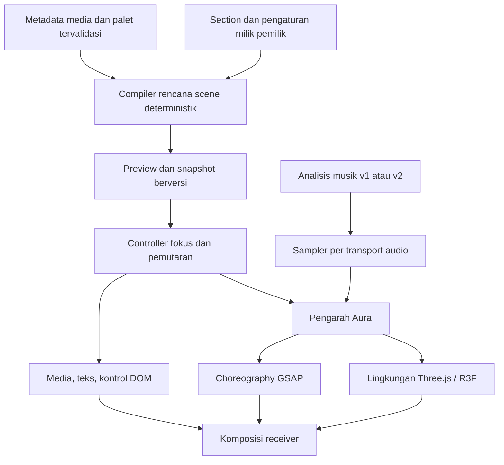

# Kenangin — Plan Aura & Receiver v2

**Revisi:** 3 · 10 Oktober 2026 · **Status:** rancangan produk dan teknis, siap menjadi dasar implementasi bertahap. Referensi Santioni diperbarui setelah penelusuran cerita dan interaksi hingga footer.

Dokumen ini menggantikan briefing sebelumnya secara menyeluruh. Isi berlabel **terverifikasi** menjelaskan kode/perangkat yang diperiksa. Konsep, struktur baru, parameter, dan paket AR adalah **rancangan yang akan dibuktikan**, bukan fitur yang sudah selesai. Penyusunan plan ini tidak menerapkan perubahan fitur atau melakukan publikasi.

**Panduan membaca:** konsep dan pengalaman penerima ada di bagian 4–6; jawaban tentang librosa/beatmap di bagian 7; struktur kode dan Studio di bagian 9–10; pembagian tools di bagian 11; urutan pengerjaan dan syarat kelulusan di bagian 13–16.

**Update implementasi, 12 Oktober 2026:** beatmap v2 dari Web Worker, Rintik Resonansi, Arus Cahaya dan Spektrum Ruang sudah terhubung langsung ke Room akun. Soundtrack Room mengendalikan Aura belakang; musik section atau suara video aktif mengendalikan Aura depan dengan clock masing-masing. Audio video dianalisis saat menyiapkan pratinjau, dan artefak v2 disimpan di luar Firestore dengan referensi immutable. Librosa/Python adalah jalur riset offline, bukan producer runtime upload. Status, bukti dan batas kemampuan terdapat di [catatan implementasi](aura-receiver-implementation.md). Baseline bagian 2 tetap keadaan saat briefing dibuat; paket roadmap tidak otomatis dianggap selesai.

**Ketetapan dua lapisan dari pengguna:** perpindahan section boleh mengganti keluarga, intensitas dan respons Aura depan. Pilihan Aura belakang tetap milik keseluruhan Room. Tanpa musik/audio sendiri, section tidak meminjam beat latar untuk menciptakan foreground. Jika musik section sama dengan soundtrack, visual berbagi satu pemutaran. Video yang benar-benar bersuara mendapat prioritas depan. Jeda satu sumber menahan lapisannya tanpa menghentikan sumber lain. Urutan yang dijalankan: timing → beatmap v2 → Rintik dengan audio nyata → keluarga Arus/Spektrum. Pengujian dilakukan melalui Room akun, tanpa halaman implementasi baru.

**Koreksi perilaku dari pengguna, 12 Oktober:** Aura mengikuti status musik. Ketika seluruh musik dijeda, mute, menunggu, gagal, atau tidak tersedia, gerak otomatis lingkungan dan denyut berhenti. Komposisi tetap terlihat dan navigasi dapat digunakan. Keputusan ini menggantikan gagasan awal ambient yang terus hidup tanpa musik.

## 1. Keputusan utama

**Arah utama: “Ruang yang Mengingat”.** Receiver merupakan pengalaman kenangan dengan ruang, media, tipografi, musik, dan interaksi yang dirancang bersama. Aura membuat ruang tersebut bereaksi sekaligus menyimpan jejak visual dari momen yang telah dilalui.

Keputusan untuk memulai pekerjaan:

1. Bebaskan komposisi receiver dari layout lama. Pertahankan isi, pilihan pemilik, pemutaran, navigasi, dan kontrak publikasi yang masih benar.
2. Buktikan dua arah visual dengan konten yang sama. Rekomendasi utama adalah **Ruang Cahaya**; **Montase Editorial** menjadi pembanding dengan mekanisme visual berbeda.
3. Bangun satu adegan khas dan satu perjalanan kecil yang lengkap sebelum membuat katalog atau engine generik.
4. Tingkatkan beatmap menjadi **data penggerak Aura yang memiliki beberapa jenis sinyal**. Detail yang ditambahkan harus mempunyai kegunaan visual dan bukti kualitas.
5. Gunakan seluruh toolset sebagai sumber kemampuan: riset, perancangan, aset, rendering, analisis, inspeksi, dan verifikasi. Setiap pekerjaan mempunyai satu alat utama; alat pengembangan tidak menjadi ketergantungan browser penerima.
6. Tentukan kualitas melalui komposisi, pengalaman nyata, dan pengukuran. Istilah “masterpiece” merupakan ambisi kreatif yang harus dibuktikan melalui hasil, bukan status kelulusan otomatis.

## 2. Titik berangkat yang terverifikasi

| Area | Kondisi sekarang | Implikasi untuk plan |
| --- | --- | --- |
| Aura aktif | Authoring v2 mengambil `compatibleAura.slice(0, 1)`; seluruh tema menempatkan `neutral` pertama. CSS jalur tersebut mematikan animasi katalog | Perlu mengganti pemilihan treatment sekaligus renderer; mengganti ID saja tidak cukup |
| Gerak tanpa musik | Jalur aktif hanya memiliki aksen gradien dari sinyal musik, tanpa animasi dasar dekoratif | Komposisi statis tetap lengkap; gerak otomatis lingkungan hanya aktif ketika musik diputar |
| Receiver | Sudah ada pembuka, foto/video/slider/teks, wishes, pengendali fokus, dan audio berlapis | Gunakan perilaku yang terbukti sebagai fondasi; tampilan dapat diganti |
| Preview | Memakai pemutar yang sama dengan receiver, dengan manifest privat | Arsitektur baru wajib mempertahankan kesamaan ini |
| Analisis MP3 pengguna | `MusicLibrary.prepare()` memanggil `analyzeRoomMusicFile()` berbasis Web Audio di browser | **Jalur aktif bukan librosa** |
| Detail musik | RMS per 50 ms; satu estimasi BPM; grid beat berjarak tetap; onset dari perubahan energi; kurva energi maksimal 160 titik; intro/outro berdasarkan proporsi durasi | Respons dasar sudah mungkin; groove, tekstur bunyi, dan perubahan struktur belum cukup terwakili |
| Librosa | Tidak ditemukan integrasi di proyek aktif; tidak tersedia pada Python default dan runtime Python bawaan yang diperiksa. Analyzer katalog dalam arsip memakai standard library Python | Perlakukan librosa sebagai komponen yang perlu disiapkan dan diintegrasikan, bukan pekerjaan yang sudah selesai. Ini tidak menyatakan tidak ada instalasi lain di komputer |
| Palet media | Palet receiver berasal dari tema. Dimensi, orientasi, brightness, serta beberapa metadata analisis media sudah tersedia; palet dominan media belum tersedia pada kontrak yang diperiksa | Pakai ulang metadata yang ada; ekstraksi warna menjadi tambahan terukur |
| Library visual | Three.js, R3F, Drei, GSAP, dan dua paket postprocessing terpasang di `package.json` | Kemampuan rendering tersedia; pemasangan paket tidak sama dengan integrasi Aura |
| MCP Three.js | `threejs-local` terdaftar; smoke test lokal sebelumnya berhasil membaca scene/uniform/renderer dan menolak mutasi. Tool khususnya belum muncul langsung pada daftar tool chat ini | Gunakan koneksi lokal yang telah diperiksa; status koneksi harus diverifikasi saat implementasi |

Bukti lokal: [audit Aura](audit-masterplan-2026-10-10.md#pemeriksaan-lanjutan-aura-pada-pratinjau-authoring-v2), [compiler](../lib/studio/authoring.ts), [CSS](../app/production.css), [MusicLibrary](../components/studio/music-library.tsx), [analyzer aktif](../lib/studio/music-client.ts), [metadata media](../lib/media-intelligence/contracts.ts), [paket proyek](../package.json), dan [bukti MCP lokal](aura-mcp-probe-2026-10-10.json).

Riwayat penghapusan katalog/generator musik dan lokasi arsip terdapat pada [kebijakan musik](music-policy.md). Peningkatan analisis MP3 tidak menghidupkan kembali katalog lagu, generator, atau blending otomatis.

## 3. Apa yang dipelajari dari Santioni

[Santioni Spirits](https://santionispirits.com/) menjadi acuan kualitas penyatuan visual, interaksi, dan penceritaan. Identitas merek, karakter, aset, adegan, serta tujuan produknya tidak menjadi rancangan Kenangin.

### 3.1 Hasil penelusuran langsung

**Koreksi terhadap revisi 2:** penilaian sebelumnya terlalu terbatas pada pembuka. Pada 10 Oktober 2026, age gate dijawab **Yes**, lalu perjalanan ditelusuri di Chrome desktop 1440 × 900 sampai bagian Collection dan footer. Interaksi **Hold & Pour** dicoba dengan tekan dan gerak pointer: botol terlihat miring dan cairan keluar. Interaksi **Hold** pada bagian transformasi juga dicoba. Instruksi **Hold & Move** pada portal terlihat, tetapi gesturnya belum diuji lengkap.

| Adegan yang terlihat | Mekanisme pengalaman yang dapat diamati | Pelajaran bagi Kenangin |
| --- | --- | --- |
| Figur berjalan dalam panel ilustrasi, diselingi detail kaki dan kepala | Pergantian ukuran panel dan jarak pandang mengarahkan perhatian | Susun urutan framing berdasarkan isi; jangan memberi semua section komposisi identik |
| Figur kecil mendekati monolit, lalu tangan memenuhi pandangan di depan portal merah | Perubahan skala membuat pengunjung merasakan perjalanan dari jauh ke dekat | Pembuka dan kedatangan media perlu mempunyai hubungan ruang yang jelas |
| Portal berlanjut ke lingkungan merah dengan kolom-kolom besar dan botol kecil | Warna, kedalaman, dan dominasi objek berubah bersama | Pergantian suasana melibatkan komposisi serta pencahayaan, bukan hanya warna latar |
| Hold & Pour memiringkan botol dan memperlihatkan cairan | Tindakan pengunjung mempunyai akibat yang sesuai objek cerita | Pilih sedikit interaksi yang mengungkap atau menghubungkan kenangan; respons pointer perlu mempunyai maksud |
| Minuman berlanjut ke mata biru, pusaran, figur terangkat, lalu arsitektur melayang | Ada persiapan, puncak, perubahan keadaan, dan pemulihan; intensitas tidak rata sepanjang cerita | Buat momen penekanan yang memiliki akibat visual, lalu kembalikan ruang untuk menikmati isi |
| Pengalaman berlanjut ke gelas, tipografi besar, Collection, dan footer | Bahasa visual tetap berhubungan ketika fungsi halaman berubah | Pembuka, momen, ucapan, dan penutup perlu terasa sebagai satu perjalanan |

Ini observasi perilaku visual dari [situs langsung](https://santionispirits.com/). Bukti sesi tersimpan di `tmp/santioni-deep-*.png` dan `tmp/santioni-deep-interaction.webm` sebagai artefak lokal sementara; bukan aset Kenangin atau bagian distribusi proyek. Audio belum dinilai dengan mendengar langsung; performa, perangkat seluler, dan seluruh variasi interaksi belum diaudit. Tidak ada klaim tentang stack internal situs. R3F/GSAP tetap merupakan pilihan stack Kenangin.

### 3.2 Keputusan desain yang diturunkan

**Receiver diperlakukan sebagai rangkaian adegan yang dikendalikan penerima.** Setiap adegan menentukan framing media, ruang baca, kedalaman lingkungan, tindakan yang tersedia, dan keadaan setelah tindakan. Aura menjadi penghubung antaradegan serta respons ruang terhadap musik dan tindakan itu. Menambah partikel di belakang layout tetap tidak memenuhi standar konsep ini.

Ambil tiga prinsip: **perubahan sudut pandang yang terarah, tindakan dengan akibat yang terlihat, dan kesinambungan dunia visual**. Contoh Kenangin: tindakan Buka memisahkan bidang cahaya hingga foto pertama terlihat; Lanjut memindahkan jejak warna ke komposisi berikutnya; memasuki pesan membuat bidang cahaya membuka area baca. Efek dan isi harus berbagi perubahan yang sama, bukan menjalankan animasi yang tak berhubungan.

Rekomendasi tetap Ruang Cahaya, dengan tata adegan pada bagian 5.5. Montase Editorial tetap pembanding yang berbeda. Ruang Cahaya wajib membuktikan hubungan cahaya, susunan media, dan tindakan penerima; refraksi atau bloom saja tidak cukup untuk meluluskan arah itu.

Tim Active Theory menjelaskan proses dari referensi, storyboard, gaya ilustrasi, framing, shader, hingga pemilihan beberapa momen interaksi utama. Mereka juga menghubungkan adegan 3D dengan tata letak informasi dan mengerjakan musik khusus bersama Plan8. Penjelasan produksi ini mendukung urutan kerja storyboard → proof interaksi → integrasi, sedangkan hasil browser di atas menjadi bukti pengalaman yang terlihat. [Studi proses oleh tim pembuat](https://lbbonline.com/news/the-notturno-experience-how-we-built-santioni-spirits-launch).

### 3.3 Batas adaptasi ke konten pengguna

Santioni menampilkan cerita dan aset yang telah ditentukan. Kenangin menerima foto seadanya, video vertikal, musik bermacam genre, pesan panjang, dan durasi baca yang berbeda. **Yang disusun adalah cara menampilkan cerita pemilik; sistem tidak mengarang kejadian, emosi, atau urutan cerita baru.** Skala dan framing berubah tanpa membengkokkan wajah, merekonstruksi foto sebagai dunia 3D, atau menimpa pilihan fit pemilik.

Scroll/pointer dapat memberi rasa bergerak di dalam ruang, tetapi tujuan fokus tetap mengikuti controller receiver. Jangan menambahkan scroll bebas yang bersaing dengan album horizontal, teks panjang, atau kontrol video. Interaksi khas harus dapat dilakukan dengan tap/tombol dan keyboard; hold/drag opsional tidak boleh menjadi syarat membuka kenangan. Tiga hal yang harus lolos sebelum memperluas desain: komposisi diam, sebab-akibat interaksi, dan adaptasi terhadap konten pengguna.

## 4. Konsep kreatif: Ruang yang Mengingat

### 4.1 Pengalaman yang ingin dirasakan

Penerima merasa seseorang menyiapkan ruang khusus untuknya. Saat sebuah momen dibuka, ruang mengambil sedikit warna dan ritmenya. Ketika penerima melanjutkan, jejaknya tertinggal sebentar sebelum menyatu dengan momen berikutnya. Foto dan pesan mendapat kehadiran emosional melalui cara ditampilkan.

Ciri khas yang akan dibuktikan:

- **Celah cahaya:** pembuka dimulai dari garis/bidang kecil yang membuka ruang bagi media pertama. Nama penerima menjadi bagian dari komposisi, tanpa menciptakan cerita atau judul baru atas nama pemilik.
- **Jejak momen:** setelah berpindah, kurva cahaya atau bidang warna dari bagian sebelumnya bertahan singkat di ruang. Jejak bersumber dari parameter visual, bukan otomatis menyebarkan salinan foto pribadi sebagai dekorasi.
- **Ruang untuk membaca:** ketika pesan panjang mendapat fokus, bidang cahaya menjauh dari kolom baca dan lingkungan melambat. Perubahan komposisi membuat keheningan terasa disengaja.
- **Pelepasan energi:** momen yang diberi penekanan dapat mengubah bentuk ruang, membuka bidang cahaya, atau mengirim lintasan partikel. Aksen mempunyai awal, puncak, dan pemulihan; tidak terus menerus membesar-mengecil.
- **Jejak penutup:** pola akhir menyatukan aksen momen yang telah dikunjungi menjadi komposisi tenang. Untuk jumlah section besar, agregasi dibatasi dan memakai seed tetap. Isi ucapan tetap utuh.

Ini usulan bahasa desain orisinal untuk proyek, bukan klaim penemuan algoritma baru. Nilainya harus dinilai melalui prototype.

### 4.2 Dua arah untuk diuji

| Unsur | A — Ruang Cahaya, rekomendasi utama | B — Montase Editorial, pembanding |
| --- | --- | --- |
| Metafora | Bidang tipis seperti kaca buram dan tirai cahaya membentuk kedalaman di sekitar kenangan | Potongan komposisi fotografi, tipografi besar, dan bidang grafis menyusun cerita |
| Komposisi | Media menjadi titik tenang dalam ruang; posisi cahaya dan ruang kosong berubah menurut jenis konten | Bingkai dan tata letak berganti ritme: spread landscape, portrait dengan kolom teks, halaman pesan |
| Material | Refraksi terbatas, tekstur sangat halus, bayangan, kontur cahaya | Permukaan matte, kontras bidang, garis, cropping dekoratif yang terpisah dari media utama |
| Perpindahan | Bidang membuka, kedalaman bergeser, jejak momen melebur | Mask geometris, pergeseran panel, perubahan skala komposisi dan tipografi |
| Risiko | Menjadi demo shader tanpa cerita; beban grafis; foto terlihat terpisah dari ruang | Menjadi editorial generik; layout gagal pada teks/rasio media yang tidak ideal |

A diprioritaskan karena metafora jejak momen menghubungkan Aura, lingkungan, dan perjalanan penerima. B tetap dibuat sebagai pembanding komposisi, bukan sekadar warna alternatif. Jika A memerlukan efek berat untuk menutupi komposisi diam yang lemah, revisi A atau pilih B berdasarkan hasil yang terlihat.

### 4.3 Kepribadian visual setelah arah dasar terbukti

Tiga keluarga berikut adalah kandidat pengganti/pengembangan tema. Nama dan jumlah final ditetapkan setelah dua proof pertama; lima nama tema lama tidak mengunci eksplorasi.

| Keluarga | Bentuk dan pencahayaan | Framing dan tipografi | Karakter gerak |
| --- | --- | --- | --- |
| Hening | Bidang translusen, cahaya menyebar, ruang putih hangat atau biru pucat | Media lapang, serif untuk judul pendek, teks tubuh bersih | Aliran panjang, sedikit titik cahaya, respons musik membentuk luas dan arah cahaya |
| Sinema | Bidang arsitektural gelap-terang, sorot terarah, bayangan dalam | Landscape lebar, portrait sebagai fokus vertikal, judul editorial terukur | Pergeseran kedalaman, sapuan cahaya, kontras sebelum/sesudah penekanan |
| Resonansi | Pita geometris, kontur energi, material padat dengan aksen terang terbatas | Framing tegas, tipografi geometris, media tetap stabil saat ditonton | Propagasi gelombang, patahan gerak terkontrol, partikel terarah pada aksen terpilih |

Keluarga menentukan bahasa visual. Intensitas menentukan kekuatan di dalam bahasa itu. Mengurangi intensitas Resonansi tidak boleh sekadar mengubahnya menjadi Hening dengan warna lain. Kombinasi efek dikurasi per keluarga agar tidak menghasilkan produk silang yang sulit diuji.

## 5. Struktur pengalaman receiver

```text
Muat manifest + komposisi statis
          ↓
Undangan / pembuka
          ↓ gestur Buka
Masuk ke momen pertama
          ↓
Momen fokus ←→ Momen fokus ←→ Momen fokus
 foto/video      slider          pesan
          ↓
Ucapan lengkap → Penutup → Ulangi / kembali ke momen
```

Pembuka dan penutup adalah bagian antarmuka perjalanan. Keduanya tidak menambah section konten, mengganti urutan, atau menulis pesan baru di draf pemilik.

### 5.1 Struktur layar

| Lapisan | Isi dan tanggung jawab |
| --- | --- |
| Lingkungan | Satu canvas yang bertahan antarsection: ruang, material, cahaya, partikel dan jejak. Memiliki komposisi statis pengganti |
| Panggung media | Foto, video, slider, dan bidang baca. Framing dapat berubah sesuai orientasi, fit, serta panjang isi |
| Aura terkait momen | Kontur/sorot dekat batas media, aksen penekanan, dan transisi. Penempatan dihitung dari area media dan zona baca |
| Teks dan kontrol | Caption, ucapan, nama, progres, tombol musik/gerakan, navigasi dan fokus keyboard |

Lapisan adalah pembagian tanggung jawab; tidak berarti empat canvas. Rancangan awal memakai satu renderer WebGL dan lapisan DOM untuk konten/kontrol. Teks dan video aktif tetap memakai kemampuan aksesibilitas/pemutaran browser.

### 5.2 Perjalanan dan perilaku

| Tahap | Tampilan dan interaksi | Aturan fungsi |
| --- | --- | --- |
| Pemuatan | Komposisi tema statis langsung memberi identitas; status aset konkret jika perlu | Tidak menunggu semua media atau shader sebelum isi pertama bisa dibaca |
| Undangan | Nama penerima, konteks Room, celah cahaya, satu tindakan Buka | Gestur membuka memulai audio jika diizinkan browser. Reduced motion mendapat pembuka statis |
| Kedatangan pertama | Cahaya membuka ruang, media hadir, kontrol muncul ketika dibutuhkan | Urutan animasi dapat diselesaikan/dilewati; tidak menahan penerima dalam intro wajib |
| Momen fokus | Satu media/teks utama dominan. Nomor bagian dan kontrol konsisten | Pemilik tetap menentukan media, fit, trim, loop, volume, caption, dan urutan |
| Perpindahan | Jejak visual menghubungkan bagian lama dan baru; kontrol langsung memberi respons | Satu gestur satu tujuan. Input baru melalui controller yang sama; timeline lama tidak boleh mengaktifkan media yang sudah ditinggalkan |
| Ucapan | Kolom baca dengan pengungkapan bertahap yang tidak memotong isi | Pesan panjang bisa digulir; isi contributor tidak diubah atau dijadikan tekstur yang sulit dibaca |
| Penutup | Lingkungan menetap menjadi jejak perjalanan; tindakan Ulangi/kembali jelas | Tanpa perpindahan otomatis yang memaksa penerima selesai membaca |

### 5.3 Aturan adaptasi konten

- **Landscape:** panggung lebar dengan ruang untuk caption; efek tidak menggelapkan wajah atau detail utama.
- **Portrait:** bidang vertikal diberi ruang samping yang dirancang. Latar tidak memakai video yang sama sebagai salinan autoplay buram.
- **Square/ilustrasi:** gunakan framing yang mempertahankan tepi dan kualitas gambar; hindari pembesaran berlebihan untuk media kecil.
- **Video:** selama pemutaran, media stabil dan kontrol tersedia. Suara video memperoleh prioritas; efek berkurang secara terukur tanpa membuat tema menghilang.
- **Slider:** indeks media di dalam section terpisah dari indeks section. Gestur horizontal untuk album tidak merebut gestur vertikal perjalanan.
- **Teks/caption panjang:** ukuran huruf baca tidak diperkecil untuk memaksa muat satu layar. Scroll internal tidak mengganti section.
- **Ponsel:** komposisi disusun ulang, bukan mengecilkan desktop. Area media, safe area perangkat, tombol, dan ruang baca menjadi masukan layout/camera.
- **Media gagal:** tampilkan retry/keterangan pada bagian tersebut. Cerita tetap dapat dilanjutkan.

Default presentasi menjaga seluruh media terlihat; pilihan `cover` pemilik tetap berlaku. Resolusi rendah, wajah, dan orientasi tidak menjadi alasan melakukan crop otomatis yang mengubah makna.

### 5.4 Navigasi yang dipertahankan dan yang berubah

Semantik watermill dipertahankan: satu tujuan fokus, berhenti stabil, lalu izinkan pemutaran section. Bentuk kartu berputar yang sekarang bukan kewajiban visual. Mode perpindahan dapat memakai kedalaman, mask, atau gerak bidang, tetapi seluruhnya mengikuti satu status `transitioning → settled`.

Soundtrack terus berjalan. Video dan musik section dijeda selama perpindahan dan mulai setelah fokus menetap. Teks panjang dan kontrol media tetap menerima inputnya sendiri. Default perjalanan tetap manual; mode film otomatis adalah scope terpisah jika kelak dibutuhkan.

### 5.5 Tata adegan: perubahan ruang mengikuti isi

Satu scene ditentukan oleh lima hal: **media fokus, framing, zona baca, bentuk lingkungan, dan tindakan menuju keadaan berikutnya**. Tata adegan memilih komposisi yang kompatibel dengan isi dan pengaturan pemilik. Ia tidak mengacak sudut kamera setiap kunjungan atau memaksakan eskalasi emosi pada urutan foto.

| Keadaan | Komposisi dan perubahan ruang | Tindakan serta akibat |
| --- | --- | --- |
| Ambang | Nama penerima di ruang lapang; celah cahaya memperlihatkan sedikit warna lingkungan | Buka memisahkan dua bidang cahaya, menghadirkan media pertama, lalu menetap. Tombol memiliki respons langsung tanpa menunggu musik |
| Hadir | Media dominan; portrait membentuk fokus vertikal, landscape panggung lebar. Kedalaman berada di sekeliling media | Setelah menetap, foto dan caption stabil. Gerak pointer opsional hanya memengaruhi ruang, tidak menggoyang media yang sedang dinikmati |
| Sambung | Bidang lingkungan lama memanjang sesaat menjadi lintasan menuju framing baru | Lanjut/Sebelumnya mengubah fokus lewat controller yang sama; jejak menuntun perhatian ke posisi media tujuan |
| Penekanan | Ruang menyiapkan bukaan lebih luas, lalu memberi satu aksen dan kembali tenang | Hanya section yang diberi penekanan atau cue yang layak memperoleh aksen. Media tidak otomatis dipercepat agar bertepatan dengan musik |
| Surat | Bidang cahaya bergeser ke samping; kedalaman berkurang, kolom baca menjadi pusat | Penerima membaca dan menggulir tanpa batas waktu. Perubahan ruang terjadi saat masuk/keluar, bukan setiap baris teks |
| Jejak akhir | Aksen dari momen yang dikunjungi tersusun menjadi komposisi tenang | Ulangi/kembali tetap jelas; pola penutup tidak menggantikan isi ucapan atau menuntut permainan tambahan |

**Interaksi khas pertama: “Membuka Ruang”.** Tap Buka atau Enter memicu pembukaan celah menuju media pertama. Varian drag pendek boleh dieksplorasi pada prototype untuk mengatur lebar celah secara langsung; saat dilepas, input diterjemahkan menjadi batal atau Buka melalui controller. Perjalanan tetap dapat dilanjutkan tanpa drag. Reduced motion langsung menampilkan komposisi akhir dengan fokus keyboard yang benar. Jika varian drag tidak menambah rasa keterlibatan atau merebut scroll, hapus varian itu, bukan akses Buka.

Sebab-akibat harus terbaca: tindakan penerima → perubahan bidang ruang → media tersingkap → posisi baca stabil. Ini hipotesis desain Kenangin yang harus dibuktikan, bukan reproduksi portal atau adegan menuang Santioni. Saat arah dibalik di tengah transisi, renderer melanjutkan dari keadaan visual saat itu dan hanya tujuan aktif yang boleh mencapai status settled.

## 6. Aura v2: sistem perilaku visual

### 6.1 Tiga rentang waktu

| Rentang | Pemicu | Peran visual |
| --- | --- | --- |
| Lingkungan lambat | Waktu animasi yang berjalan hanya ketika musik terdengar, karakter keluarga, seed | Bentuk ruang mengalir dan cahaya bergeser selama musik berjalan; berhenti ketika seluruh musik dijeda atau tidak terdengar |
| Ritme | Energi beberapa pita frekuensi, onset, beat yang tersedia | Bass memengaruhi bentang/deformasi lingkungan; onset memberi aksen singkat; tekstur frekuensi tinggi memengaruhi detail cahaya |
| Momen cerita | Section menetap, penekanan pemilik, perubahan struktur musik yang layak | Satu perubahan bermakna: ruang terbuka, lintasan cahaya, komposisi penutup |

Gerak lambat bukan beat palsu. Bass bukan otomatis kick; frekuensi tinggi bukan otomatis hi-hat. Hubungan sinyal-ke-visual merupakan keputusan artistik yang dapat diuji, bukan pengenalan instrumen.

### 6.2 Enam treatment awal

| Treatment | Mekanisme dan tampilan | Kapan digunakan |
| --- | --- | --- |
| Aliran cahaya | Bidang/deformasi shader berkecepatan rendah; arah mengikuti komposisi | Lingkungan selama musik berjalan; tanpa musik komposisi statis |
| Kontur momen | Sorot mengikuti batas panggung; area teks dikecualikan | Menegaskan media fokus tanpa mengubah isi foto |
| Jejak peralihan | Parameter bentuk/warna lama melebur ke keadaan baru | Perpindahan section dan pergantian media slider |
| Riak resonansi | Gelombang menjalar melintasi lingkungan dengan amplitudo terbatas | Beat/onset terpilih, terutama keluarga Resonansi |
| Pelepasan aksen | Lintasan partikel/bukaan bidang dengan fase masuk, puncak, dan tenang | Penekanan atau cue musik yang lolos aturan; bukan pada setiap beat |
| Ruang hening | Kepadatan dan gerak menyusut, sorot menjaga area media/baca | Pesan panjang, video bersuara, akhir pengalaman |

Rancangan awal mengizinkan satu treatment dasar dan satu aksen dominan sekaligus. Treatment tidak boleh berebut transform dengan navigasi. Warna media hanya memberi aksen dalam batas keluarga, sementara kontras teks tetap dikendalikan tema.

### 6.3 Pengarah Aura

Pengarah Aura adalah aturan deterministik yang menggabungkan niat pemilik, jenis konten, status pemutaran, sinyal musik, dan preferensi gerak. Ia tidak meminta model AI menulis efek pada runtime.

Urutan keputusan:

1. Tentukan ruang baca dan media fokus serta apakah video sedang terdengar.
2. Terapkan pilihan gerakan penerima, reduced motion, dan status audio yang benar-benar diputar. Tombol musik aktif belum membuktikan audio sedang berjalan.
3. Ambil sinyal soundtrack untuk lingkungan dan musik section untuk aksen dekat media.
4. Pilih treatment yang kompatibel dengan keluarga dan jenis konten.
5. Terapkan amplitudo, penghalusan, batas kepadatan, dan waktu pemulihan antaraksen.
6. Kirim parameter yang sama kepada adaptor DOM, shader, dan partikel sesuai tanggung jawabnya.

Rumus konseptualnya: `keadaan visual = komposisi dasar + gerak lingkungan + respons musik terbatas + aksen cerita yang diizinkan`. Komponen ini memiliki kanal berbeda; jangan menjumlahkannya sebagai satu angka yang menggerakkan semua elemen serentak.

Penekanan menyambut section sekali setiap kunjungan yang sudah menetap. Cuplikan musik dengan energi terus tinggi tidak boleh memicu ledakan tanpa jeda. Cooldown, batas emisi, dan amplitudo per keluarga ditetapkan melalui proof, lalu disimpan pada katalog versi tertentu.

### 6.4 Matriks keadaan wajib

| Keadaan | Hasil |
| --- | --- |
| Tanpa musik / belum diputar | Komposisi statis; gerak otomatis Aura berhenti. Pembukaan dan navigasi tidak menunggu keberhasilan audio |
| Semua musik dijeda / mute / volume nol / menunggu / gagal | Sinyal musik nol; waktu lingkungan, render kontinu, dan tween yang sedang berjalan dijeda. Gerak dilanjutkan saat musik terdengar jika preferensi gerakan aktif |
| Respons musik off, audio diputar | Gerak lingkungan dapat berjalan; tidak ada denyut beat atau energi |
| Hanya soundtrack | Respons musik pada lingkungan; aksen momen tetap bisa berasal dari penekanan pemilik |
| Musik section aktif | Aksen depan mengikuti track section; respons soundtrack ditenangkan sesuai prioritas audio |
| Lagu sama pada dua peran | Satu transport dan satu analisis. Satu event memiliki identitas agar tidak menjadi dua ledakan yang identik |
| Video bersuara | Ducking yang ada dipertahankan; gerak dekat media turun agar isi video dominan |
| Aura latar off | Komposisi lingkungan tetap statis; efek/partikel latar berhenti |
| Transisi tanpa gerakan | Fokus berpindah langsung. Kontrol transisi tidak diam-diam mematikan Aura dasar |
| Gerakan off / reduced motion | Semua gerak dekoratif dan denyut berhenti; layout statis tetap selesai secara visual |
| Tab tersembunyi | Audio/video mengikuti kebijakan pause yang ada; render dekoratif dihentikan. Saat kembali tidak memutar ulang rentetan event yang terlewat |
| Beatmap gagal / kualitas rendah | Gunakan sinyal yang valid atau baseline lingkungan. Konten tidak kosong dan beat tidak dikarang |
| WebGL gagal | Media, teks, kontrol dan komposisi statis tetap bekerja |

Perlu perubahan dokumentasi produk pada tahap integrasi: kebijakan lama membatasi Aura menjadi cahaya kecil. Plan ini membuka gerak lebih ekspresif pada lingkungan/aksen yang dipilih, sambil mempertahankan teks stabil, kendali penerima, dan larangan strobe. Perubahan itu harus diuji lalu dicatat; belum diterapkan sekarang.

## 7. Peningkatan beatmap menjadi music-features/v2

### 7.1 Mengapa data sekarang belum cukup

Kurva aktif maksimal 160 titik. Pada lagu empat menit, setiap titik mewakili sekitar `240 / 160 = 1,5 detik`; pada batas 20 menit sekitar 7,5 detik. Ini cukup untuk kecenderungan energi yang lambat, tetapi meratakan banyak perubahan cepat. Beat timestamps disimpan terpisah; kekurangan kurva tersebut tidak berarti seluruh beatmap hanya beresolusi 1,5 detik.

Grid beat sekarang dibuat dari satu BPM dan satu fase awal. Karena posisi berikutnya dihitung dengan penambahan periode yang sama, tempo berubah atau estimasi fase yang meleset dapat menghasilkan drift. Puncak energi sekarang dipilih dari maksimum envelope, sedangkan intro/outro memakai persentase durasi. Label itu belum membuktikan intro, chorus, build, atau drop musikal.

Prioritas upgrade: **waktu yang tepat, beberapa sinyal dengan fungsi berbeda, dan kualitas yang diketahui**. Menambah jumlah titik dari output lama tanpa menghitung ulang tidak mengembalikan detail yang sudah hilang.

### 7.2 Kontrak data baru: `music-features/v2`

Istilah “beatmap” boleh tetap digunakan pada UI. Secara teknis artefaknya menampung beberapa sinyal berikut:

| Data | Metode/rute awal | Pemakaian visual | Prioritas |
| --- | --- | --- | --- |
| Beat timestamps dan kekuatan lokal | Tracking dari onset envelope; pembanding librosa `beat_track` | Fase/denyut yang konsisten, aksen selektif | Wajib |
| Onset timestamps dan strength | Perubahan spektrum, bukan hanya kenaikan volume | Kilau, riak, atau emisi singkat | Wajib |
| Energi total | RMS dengan normalisasi terdokumentasi | Luas cahaya dan amplitudo lingkungan | Wajib |
| Energi low/mid/high | Agregasi pita spektrum | Memisahkan bentang lingkungan, bentuk, dan detail cahaya | Wajib |
| Kecerahan spektrum | Spectral centroid yang dipetakan ke rentang visual | Ketajaman/material cahaya; tidak mengganti seluruh palet setiap frame | Tahap kedua |
| Aktivitas transient dan rentang hening | Statistik onset dan ambang energi yang diuji | Mengurangi efek saat musik jarang atau hening | Wajib |
| Kandidat perubahan struktur | Perubahan fitur antarjendela waktu, kemudian diuji | Pergeseran bentuk besar yang jarang | Eksperimental |
| Cue yang ditandai manusia | Timestamp eksplisit dan asal anotasi | Aksen penting pada prototype atau koreksi lanjutan | Didukung kontrak; editor lengkap bukan syarat awal |
| Downbeat, kick/snare, vokal, chorus/drop | Model/inferensi khusus atau anotasi | Choreography semantik lanjutan | Di luar baseline v2 |

`librosa.beat.beat_track` memperkirakan beat dari onset dan tempo; fungsi ini tidak mengeluarkan label drop atau instrumen. Ia juga dapat menghasilkan beat kosong pada input tanpa onset. **BPM boleh tidak diketahui** pada kontrak baru; jangan memaksa musik hening/ambient menjadi 90 BPM agar lolos schema lama. [Dokumentasi beat tracking](https://librosa.org/doc/0.11.0/generated/librosa.beat.beat_track.html).

Librosa menyediakan spectral-flux onset strength, RMS, spectral centroid, dan segmentasi fitur. Hasil segmentasi adalah batas kandidat, belum nama bagian lagu. Penggunaan fitur tersebut untuk pemetaan visual di atas adalah rancangan Kenangin. [Onset strength](https://librosa.org/doc/0.11.0/generated/librosa.onset.onset_strength.html), [RMS](https://librosa.org/doc/0.11.0/generated/librosa.feature.rms.html), [centroid](https://librosa.org/doc/0.11.0/generated/librosa.feature.spectral_centroid.html), [segmentasi](https://librosa.org/doc/0.11.0/generated/librosa.segment.agglomerative.html).

### 7.3 Detail awal yang akan diukur

- Referensi analisis awal: audio mono 22.050 Hz, FFT 2.048, hop 512 untuk fitur spektrum; jarak antarframe sekitar 23 ms. Ini parameter percobaan, bukan jaminan akurasi onset 23 ms.
- Simpan event beat/onset sebagai waktu detik, terpisah dari kurva kontinu. Ekspor kurva pada sekitar 20 sampel/detik dengan interpolasi runtime; renderer tetap mengikuti frame rate layar.
- Mulai dari pita low 20–180 Hz, mid 180–2.000 Hz, high 2.000–8.000 Hz sebagai pembagian artistik yang diuji. Simpan batas pita di metadata; jangan menyebut hasilnya stem instrumen.
- Gunakan normalisasi robust per lagu dan ambang hening. Rekaman sunyi tidak boleh diperbesar menjadi energi maksimal hanya karena semua nilai kecil dibagi nilai maksimum kecil.
- Nyatakan kebijakan mono/stereo dan deteksi pembatalan fase. Jangan menganggap penjumlahan dua kanal selalu mempertahankan energi.
- `startTimeSec`, sample rate, hop, frame centering, decoder, dan offset harus eksplisit. Uji kesesuaian waktu hasil decoding dengan `currentTime` elemen media yang memainkan file asli.
- Ukur beda waktu aksen yang dijadwalkan terhadap event, dengan target teknis awal p95 ≤50 ms pada perangkat uji. Ini berbeda dari akurasi deteksi beat musikal, yang memerlukan anotasi pembanding dan pemeriksaan dengar.

### 7.4 Bentuk artefak

Kontrak konseptual berikut belum merupakan schema yang diterapkan:

```text
MusicFeaturesV2
  schemaVersion, sourceAudioHash, analysisHash
  analyzer: nama, versi library/algoritma, versi parameter, decoder
  durationSec, sampleRate, hopLength, timeBase, timingOffsetSec
  normalization: metode, rentang, ambang hening, bandEdgesHz
  rhythm: bpm nullable, beatEvents[], onsetEvents[]
  curves: energy, low, mid, high, brightness?, activity
          setiap kurva: startTimeSec, sampleRateHz, encoding, values
  cues[]: id, timeSec, kind, strength, source, qualityScore?
  quality: flags[], beatUsability, timingValidated
```

Kekuatan event bukan probabilitas bahwa event benar. `qualityScore` hanya diisi bila metode penilaiannya didefinisikan; confidence yang belum tersedia tidak boleh dibuat-buat. Beat usability rendah menggunakan aliran energi atau gerak dasar, bukan tetap memaksakan denyut kuat.

Validasi: nilai finite, waktu terurut dan berada dalam durasi, panjang kurva sesuai metadata, amplitudo terbatas, hash cocok, versi didukung. Receiver hanya membaca bentuk tervalidasi; kegagalan satu kurva menurunkan fitur terkait dengan fallback yang jelas.

### 7.5 Peran librosa dan jalur produksi

**Rekomendasi awal: gunakan librosa sebagai extractor referensi dan pembuat fixture lokal; tingkatkan producer browser untuk alur pengguna. Keduanya menghasilkan kontrak v2 yang sama.** Ini memanfaatkan librosa untuk membandingkan kualitas tanpa menjadikan laptop pengembang syarat pemrosesan MP3 pengguna.

```text
Lab pengembangan:
Audio fixture → Python/librosa → music-features/v2 → pembanding dengar/visual

Alur pengguna yang ditingkatkan:
MP3 pengguna → decode browser → DSP pada Worker → validasi v2
             → artefak privat/hash → preview → publikasi → receiver
```

Pembagian ini mempunyai trade-off: algoritma browser harus dibuktikan, dan hasilnya tidak otomatis setara dengan librosa. Cantumkan producer/version pada setiap artefak. Worker memindahkan pekerjaan DSP dari thread UI, tetapi tidak menghilangkan memori hasil decoding. Analisis 20 menit memerlukan pemeriksaan memori/latensi; jangan mengklaim aman hanya karena file MP3 kecil.

Pada fase audio, benchmark durasi pendek, empat menit, dan batas 20 menit. Browser yang tidak mampu memproses analisis lanjut tetap mendapat analisis dasar/gerak lingkungan; unggahan, draf, dan isi cerita tidak hilang. Status analisis membedakan `basic`, `detailed`, `processing`, dan `failed` tanpa mengubah label lama sebelum migrasi siap.

**Kondisi untuk mengubah rekomendasi:** jika analisis browser tidak memenuhi timing, responsivitas, atau penggunaan memori pada perangkat sasaran, tambahkan job Python/librosa privat sebagai keputusan arsitektur tersendiri. Definisikan pemicu, autentikasi, retry/idempotency, batas waktu/ukuran, biaya dan cleanup sebelum mengaktifkannya. Librosa lokal, MCP lokal, dan route Next.js JavaScript tidak otomatis menyediakan layanan Python produksi. Pemrosesan berat tidak diletakkan di jalur pembukaan receiver atau transaksi publish sinkron.

Nama `browser-dsp-v2` dan `librosa-offline-v2` perlu dibedakan pada provenance. Producer browser mengadopsi algoritma yang telah dipilih dan diuji; tidak mengeksekusi package Python librosa secara langsung. Keputusan memakai implementasi DSP yang ada atau menulis adaptor dibuat setelah pemeriksaan dependensi dan lisensinya, dengan pembanding fixture yang sama.

Versi Python dan librosa dipin setelah smoke test kompatibilitas; dokumentasi 0.11.0 yang dirujuk di sini adalah sumber API yang diperiksa, bukan klaim versi terbaru atau versi yang telah terpasang.

### 7.6 Ukuran, penyimpanan, dan migrasi

Enam kurva × 20 Hz × 1.200 detik × 2 byte = **288.000 byte** sebelum event, metadata, dan overhead encoding. Angka ini mengasumsikan penyimpanan nilai 16-bit; JSON angka biasa dapat jauh lebih besar. Ukur ukuran file dan memori parsing sebelum memilih quantization, binary, atau pembagian menjadi chunk. Jangan mengirim spectrogram lengkap bila runtime hanya memerlukan beberapa kurva.

- Artefak v2 tetap menjadi aset privat di B2 dengan hash, mengikuti pola beatmap immutable yang sudah ada.
- Snapshot menyimpan referensi dan versi, bukan seluruh array yang memperbesar dokumen Firestore.
- Identitas analisis mencakup audio hash, algoritma, parameter, dan versi. Signed URL tidak menjadi identitas cache.
- Producer, API validasi, repository musik, preview, publisher, resolver, cache, dan sampler harus diperbarui bersama. Mengganti analyzer saja akan terbentur batas schema/reader lama.
- Analisis hanya dilakukan ulang ketika sumber/versi berubah atau pengguna memintanya; membuka receiver tidak memicu analisis.
- V1 tetap dibaca melalui adaptor: data yang ada dipakai, data yang tidak ada ditandai tidak tersedia. Tidak mengarang bass, downbeat, atau confidence dari kurva energi lama.
- Reanalisis draf tidak mengubah artefak yang dipakai snapshot terbit. Perubahan sampai ke penerima melalui revisi publikasi.

## 8. Sinkronisasi: penerima tetap menentukan perjalanan

Soundtrack dan musik section dapat berada pada waktu berbeda. Ada satu otoritas untuk masing-masing domain waktu, dikelola oleh satu koordinasi pemutaran:

| Domain | Sumber waktu | Konsumen |
| --- | --- | --- |
| Musik latar | Posisi aktual audio soundtrack | Sampler sinyal latar |
| Musik section | Posisi aktual track section; memakai transport latar jika lagu sama | Sampler sinyal depan |
| Perpindahan | Controller navigasi dan status settled | Choreography media/lingkungan |
| Gerak dasar | Waktu monotonic bersama yang bisa dibekukan | Aliran lingkungan tanpa musik |

GSAP dan R3F membaca hasil koordinasi tersebut. RAF adalah kesempatan menggambar frame, bukan timer beat tambahan. Sampling musik dibuat sebagai fungsi yang bisa menjawab keadaan pada waktu mana pun, sehingga pause, seek, loop, dan kembali ke section tidak membutuhkan replay seluruh riwayat.

Aturan event:

- Event sekali pakai dipicu ketika playhead melewati timestamp, lalu dicatat menurut track, event ID, dan siklus playback.
- Seek tidak menembakkan semua event yang dilewati. Loop memulai siklus baru sesuai kebijakan efek.
- Keluar section membatalkan timeline dan cue milik kunjungan itu. Callback lama tidak boleh menyalakan audio/video lagi.
- Soundtrack kontinu tidak dikembalikan ke awal hanya untuk menyamakan efek.
- Pengguna dapat membaca foto pertama ketika lagu sudah mencapai puncak. Respons besar boleh mengubah lingkungan saat itu, tetapi tidak otomatis memindahkan foto.
- Penekanan section dan cue musik dapat bertemu, tetapi pengarah Aura memilih satu aksen dominan agar tidak menumpuk.

## 9. Arsitektur dan struktur proyek yang dituju

### 9.1 Aliran data



### 9.2 Struktur modul usulan

Nama berikut merupakan lokasi yang akan dibuat/refactor pada tahap implementasi, bukan berkas yang sudah tersedia:

```text
app/dev/aura-lab/                 # route development, tertutup pada produksi
components/receiver/
  receiver-experience.tsx         # integrasi; pecah secara bertahap
  scene-stage/                   # layout foto, video, slider, pesan, ucapan
  atmosphere/                    # satu canvas + keluarga material/lingkungan
  choreography/                  # timeline terputuskan, transisi, state masuk/keluar
  controls/                      # progres, musik, gerakan, akses keyboard
lib/receiver/
  scene-plan/                    # kompilasi dan aturan komposisi
  aura/                          # pemilihan treatment dan adaptasi sinyal
  audio-signals/                 # reader v1/v2, sampler, event crossing
lib/audio-analysis/              # kontrak v2 dan producer browser/Worker
config/receiver-worlds/          # keluarga visual, parameter, kompatibilitas
public/creative/receiver/        # aset kurasi berversi, poster fallback
tools/audio-analysis/          # extractor librosa dan fixture pengembangan
tests/receiver/                # pengujian perilaku/kontrak yang bermakna
docs/receiver-evidence/         # storyboard, rekaman, jejak performa, keputusan
```

Struktur final mengikuti konvensi repo. Direktori dan modul dibuat bertahap saat ada implementasi yang membutuhkannya.

### 9.3 Kontrak scene dan kompatibilitas

`ReceiverScenePlan` minimal membawa versi renderer, ID/versi keluarga, seed, layout kind, referensi section/media, treatment IDs, intensitas, kebijakan respons audio, transisi, serta fallback. Ukuran viewport tetap diselesaikan di client; simpan aturan layout, bukan koordinat desktop yang dipaksakan ke ponsel.

Rencana dikompilasi dari pilihan pemilik dan metadata yang sudah ada. Gemini Media Intelligence dapat memberi metadata tambahan bila tersedia, tetapi tidak mengubah urutan, mengarang ucapan, atau menjadi syarat receiver bisa berjalan. Tidak ada panggilan Gemini saat penerima membuka cerita.

Renderer lama dan baru harus dapat dibedakan. Jangan mengganti implementasi di balik ID tema lama lalu menganggap snapshot lama immutable secara visual. Snapshot memerlukan versi katalog/aset dan renderer yang dipin; jalur lama dipertahankan sampai kebijakan migrasi eksplisit lulus tes. Preview dan publish memakai compiler serta renderer yang sama.

### 9.4 Batas antarrenderer

- DOM memiliki teks, kontrol, playback video, dan semantik aksesibilitas. Foto dapat memakai plane WebGL selama transisi bila ada manfaat yang terbukti; presentasi fokus harus tetap tajam.
- Jika video perlu menjadi texture, sumbernya adalah elemen video yang sama. Tidak membuat pemutaran kedua untuk efek.
- Canvas menghitung alignment dari kotak media/zona baca aktual. Ukuran font, resize, orientasi, dan DPR harus memperbarui komposisi.
- Bloom, blur, dan postprocessing hanya memengaruhi pixel canvas. Teks HTML tidak otomatis ikut kompositor; efek lintaslapisan membutuhkan masking/alignment yang sengaja dirancang.
- Satu penanggung jawab per properti transform. Navigasi, pergeseran dekorasi, dan pulse tidak menulis transform elemen yang sama secara bersamaan.
- React menyimpan status semantik. Nilai per frame berada pada ref/uniform; hindari render React untuk setiap partikel/beat.
- Teardown melepas timeline, listener, texture, material, framebuffer, dan akses aset. Cache GPU memakai batas kapasitas dan eviction; semua section tidak diunggah menjadi texture sekaligus.

## 10. Struktur Studio bagi pemilik

Empat tahap authoring yang ada tetap menjadi fondasi: **Momen → Atur Cerita → Musik → Pratinjau & Suasana**.

Pada Pratinjau & Suasana:

1. **Dunia visual:** pilih keluarga dengan cuplikan bergerak yang menunjukkan konten beragam.
2. **Kekuatan suasana:** Tenang / Berwarna / Energik atau label hasil pengujian; perbedaan terlihat pada bentuk, ritme, serta kepadatan.
3. **Respons musik:** tidak mengikuti musik / aliran energi / aksen irama. Kontrol tidak menjanjikan deteksi drop jika data belum mendukungnya.
4. **Perpindahan:** pertahankan pilihan watermill/lembut/tanpa gerakan melalui adaptor ke choreography baru.
5. **Per section:** penekanan, override suasana yang sudah ada, dan musik section. Pilihan baru mengikuti global kecuali diubah pemilik.
6. **Preview:** kontrol musik dan gerakan sama dengan receiver; mode pemeriksaan tanpa musik membantu membuktikan desain dasar.

Editor cue musik terperinci, koreksi beat manual, dan perpindahan mode otomatis bukan syarat rilis awal. Data anotasi dapat didukung di lab terlebih dahulu. Jumlah kontrol dijaga agar pembuatan kenangan tidak berubah menjadi penyuntingan timeline profesional.

## 11. Pemanfaatan MCP, tools, library, dan skills

Peta ini membedakan **alat yang dipakai pengembang** dari **kode yang dikirim ke penerima**. “Memanfaatkan seluruh toolset” berarti kemampuan relevannya digunakan pada tahap yang tepat. Memanggil beberapa alat untuk bukti yang sama tidak meningkatkan kualitas.

### 11.1 Library dan platform

| Kemampuan | Status saat revisi | Tugas dalam rencana |
| --- | --- | --- |
| Next.js / React / TypeScript | Aktif | Route, server/client boundary, UI, kontrak, compiler scene. Baca dokumentasi Next lokal sebelum perubahan kode |
| Three.js + React Three Fiber | Terpasang | Rendering lingkungan dan material; R3F menjadi pengelola scene React di atas Three.js |
| Drei | Terpasang | Helper yang benar-benar diperlukan, misalnya loading/texture/geometry; bukan paket efek yang semuanya diaktifkan |
| GSAP | Terpasang | Pembuka, choreography perpindahan, interpolasi parameter dan cleanup timeline |
| `@react-three/postprocessing` + `postprocessing` | Terpasang | Kompositor untuk efek terpilih setelah A/B membuktikan peningkatan visual; jumlah pass diukur |
| GLSL/shader | Teknik yang tersedia melalui Three.js | Aliran, kontur, masking, refraksi semu, dan propagasi gelombang. Tidak memerlukan MCP shader khusus |
| Web Audio + Worker | Web Audio aktif; jalur Worker DSP direncanakan | Decode/sinyal browser, pemrosesan tanpa mengunci UI, transport dan gain audio |
| Python + librosa | Python tersedia; librosa belum ditemukan di runtime yang diperiksa | Extractor referensi, fixture, plot fitur dan evaluasi timing; pemasangan lingkungan terkunci pada tahap audio |
| FFmpeg | Tercatat tersedia pada inventaris sebelumnya; validasi ulang sebelum dipakai | Decode/normalisasi format fixture dan pemeriksaan audio, tanpa membuat lagu atau mengganti audio pengguna |
| Firebase / B2 / Zod | Aktif | Validasi, metadata, artefak privat, manifest dan publikasi berversi |
| Gemini Media Intelligence | Integrasi sudah ada | Metadata pendukung yang telah tersedia; optional hint dengan fallback deterministik |

### 11.2 MCP dan alat kerja

| Alat | Bukti ketersediaan | Pemakaian dan hasil yang diharapkan |
| --- | --- | --- |
| Context7 | Tool tersedia; dokumentasi librosa berhasil diambil pada revisi ini | Memastikan API dan batas kemampuan sebelum menulis adaptor |
| Web | Digunakan pada revisi ini | Membaca referensi dan sumber primer; setiap rujukan menjelaskan prinsip yang diambil |
| Playwright CLI | Tersedia; browser referensi berhasil dibuka/ditutup | Fixture desktop/ponsel, screenshot, rekaman gerak, interaksi dan regresi yang dapat diulang |
| Chrome DevTools MCP | Konfigurasi aktif dan tool terlihat; profiling baru belum dijalankan | Trace CPU/frame, long task, loading, console dan memory ketika prototype ada |
| Three.js DevTools lokal | Terdaftar; smoke test lokal terdokumentasi | Inspect scene, material, uniform dan renderer info. Statistik renderer bukan pengukuran FPS lengkap |
| CUA browser / Node REPL | Terlihat pada sesi; bukan bukti native-app control tersedia | Peninjauan/interaksi browser ketika berguna; analisis data/artefak sesuai kemampuan yang tersedia |
| Cefax lokal | Discovery dijalankan; tidak ada capability tambahan yang cocok untuk analisis musik pada revisi ini | Penemuan capability/evidence bila diperlukan; tidak diasumsikan sebagai extractor librosa |
| Code Review | Tool host terlihat, konfigurasi CLI lokal tercatat disabled | Verifikasi koneksi sebelum review implementasi; pemeriksaan langsung kode tetap dapat dilakukan |
| ImageGen | Tool tersedia; belum dipakai pada revisi ini | Eksplorasi storyboard/tekstur/aset raster bila membantu. Hasil gambar tidak dianggap bukti animasi/renderer berjalan |
| Codex file/preview tools | Tersedia | Menulis plan, membuka artefak, memperlihatkan bukti desain dan hasil review |
| Terminal, Git, skrip pemeriksaan | Tersedia | Inspeksi dependensi, validasi artefak, pengukuran dan diff terfokus |

MCP Three.js harus memakai **salinan lokal** yang sudah diuji, dengan `ALLOW_MUTATIONS=0` sebagai keadaan awal. Koneksi bridge dibatasi untuk pengembangan; server MCP, token pairing, dan endpoint inspeksi tidak dimasukkan ke build publik. Tidak mengganti salinan tersebut dengan unduhan upstream hanya karena tool native belum terlihat.

Tools konektor lain dipakai bila ada kebutuhan nyata dan koneksi yang terverifikasi. Figma atau GitHub MCP tidak dianggap terpasang hanya karena tersedia pada daftar rekomendasi plugin. Publikasi aplikasi dan pengiriman ke pihak lain merupakan tindakan terpisah dari pembuatan plan/prototype.

### 11.3 Skills sebagai prosedur kerja

- `evolve-ui-to-god-tier`: arah visual, dua konsep yang berbeda, penilaian komposisi dan pengalaman.
- `creative-stack-orchestrator`: pembagian peran library, kontrak data, waktu dan lifecycle.
- `make-interfaces-feel-better`: tipografi, framing, respons kontrol dan detail responsive.
- `12-principles-of-animation`: staging, timing, anticipation, follow-through, serta fokus perhatian.
- `playwright-cli`: bukti browser dan regresi interaksi.
- `web-optimization`: profiling dan optimasi yang mempertahankan karakter visual.
- `imagegen`: ketika aset raster diperlukan; tidak menggantikan pengerjaan scene yang dapat dirender.
- `master-research`: hanya bila masalah ekstraksi/algoritma membutuhkan riset khusus setelah metode standar diuji.

Skills dibaca saat digunakan; daftar ini adalah pembagian peran, bukan klaim semua prosedurnya sudah dijalankan. Skill dokumen/presentasi/visualisasi dapat dipakai untuk artefak pendukung bila diperlukan, tanpa menambah dependensi receiver.

## 12. Pipeline desain dan aset

1. **Susun referensi terarah:** komposisi, material, transisi, tipografi, serta hubungan musik. Catat alasan setiap referensi; tidak hanya mengumpulkan gambar yang terlihat bagus.
2. **Buat storyboard dengan konten representatif:** portrait, landscape, square, video, caption panjang, pesan tanpa media, dan ucapan.
3. **Tentukan tiga frame penting:** sebelum interaksi, ketika aksen memuncak, dan setelah kembali tenang. Ketiganya harus memiliki komposisi yang masuk akal.
4. **Produksi aset milik Kenangin:** shader/prosedural untuk bentuk yang adaptif; tekstur, ilustrasi, atau model hanya jika material itu diperlukan. Catat sumber/lisensi aset dan font.
5. **Validasi diam dan bergerak:** warna, hierarchy, framing, dan keterbacaan dinilai sebelum kompleksitas efek ditambah.
6. **Buat aset fallback bersamaan:** poster/komposisi statis menjaga identitas saat gerakan atau WebGL dimatikan.

Palet media diekstrak dari proxy kecil yang memang sudah tersedia/diizinkan. Untuk video, gunakan frame sampel yang stabil sebagai awal; jangan menganalisis setiap frame hanya untuk mengejar perubahan warna. Hash palet terhubung ke media, dan pilihan pemilik mengalahkan hasil otomatis. Palet baru tidak mengubah tint pixel foto/video utama.

Kualitas aset harus bertahan pada resolusi perangkat yang ditargetkan. File besar, tekstur transparan bertumpuk, dan terlalu banyak pass diperiksa melalui pengukuran, bukan diatasi dengan mematikan semua efek setelah desain selesai.

## 13. Paket implementasi dan dependensi

Tabel di bawah menetapkan **target dan syarat kelulusan**, bukan status selesai. Implementasi inti per 12 Oktober telah memenuhi sebagian target; status rinci dan pekerjaan tersisa dicatat dalam [catatan implementasi](aura-receiver-implementation.md#batas-penyelesaian-terhadap-roadmap). Audit atau keberadaan dokumen tidak otomatis berarti sebuah paket lulus. Kode AR hanya untuk program Aura/Receiver, bukan penggantian status 12 patch lama.

| Paket | Pekerjaan dan hasil konkret | Dependensi / syarat lulus |
| --- | --- | --- |
| AR-00 — Baseline dan fixture | Catat kondisi receiver, kebijakan audio, snapshot lama, tool lokal; buat dataset visual/audio yang diizinkan dan deterministic seed | Matriks konten serta kasus regresi tersedia; sumber audio/analisis dapat ditelusuri |
| AR-01 — Pembuktian arah | Storyboard A/B dengan foto/teks yang sama, desktop dan ponsel; tentukan keluarga awal, type system dan zona baca | Perbedaan mekanisme dan komposisi jelas; arah utama dinilai dari hasil visual. Pembahasan dengan pengguna berfokus pada artefak yang konkret |
| AR-02 — Adegan khas | Eksperimen 10–15 detik Membuka Ruang → media → jejak → framing berikut; perluas menjadi perjalanan pendek dengan pesan dan penutup | Tindakan mengubah adegan dengan akibat yang terbaca; framing berubah sesuai isi; tap/keyboard, interupsi dan reduced motion berhasil. Mode diam/tanpa musik menarik; cue manual diberi label |
| AR-03 — Musik v2 | Siapkan lingkungan librosa, extractor referensi, kontrak v2, producer browser, perbandingan dengar, penyimpanan dan adaptor v1 | Beat/onset/kurva tervalidasi; memory/latency diukur; keputusan producer produksi dibuat berdasarkan hasil |
| AR-04 — Engine receiver | Pisahkan panggung, lingkungan, choreography, sampler dan pengarah Aura; implementasi lifecycle serta fallback sejak awal | Dua domain audio sinkron sesuai track; input cepat, resize, pause, seek, loop dan teardown benar |
| AR-05 — Studio dan publikasi | Hubungkan kontrol, penekanan, metadata, versioning dan manifest. Integrasikan artefak v2 dan pembacaan snapshot lama | Pengaturan yang sama menghasilkan preview/publikasi yang sama; draf tidak mengubah snapshot terbit |
| AR-06 — Keluarga visual | Lengkapi keluarga utama dan satu keluarga dengan bahasa berbeda; keluarga ketiga setelah sistem terbukti | Masing-masing lulus matrix konten dan motion; bukan reskin shader identik |
| AR-07 — QA dan performa | Uji perangkat, kualitas adaptif, audio, kegagalan aset, aksesibilitas, rekaman dan profiling | Bukti menunjukkan fungsi dan kualitas visual; batas yang belum diuji ditulis jelas |
| AR-08 — Persiapan rilis | Review perubahan, kebijakan migrasi, fallback/rollback, dokumentasi musik/Studio dan hasil penerimaan | Kandidat rilis reviewable; deployment dilakukan sebagai tindakan terpisah sesuai instruksi pengguna |

Urutan kritis: AR-00 → AR-01 → AR-02 → AR-04 → AR-05 → AR-07 → AR-08. AR-03 dapat dikerjakan setelah AR-00 dan harus selesai sebelum klaim musik v2 pada AR-04/05. AR-06 mengikuti AR-04 dan harus lulus AR-07 untuk keluarga yang ikut rilis. Ini memungkinkan eksplorasi desain tetap berjalan tanpa menunggu riset deteksi musik selesai.

Setiap paket menyerahkan: perubahan terfokus, rekaman/screenshot yang relevan, hasil pengujian, keterbatasan, dan keputusan berikutnya. Estimasi durasi dibuat setelah AR-02/03 mengungkap biaya desain, ekstraksi, dan perangkat. Jangan memakai jumlah file atau pemasangan library sebagai indikator kemajuan visual.

## 14. Skenario proof pertama

Dataset kecil: satu foto portrait biasa, satu foto landscape, satu video pendek bersuara, satu pesan panjang, dan satu kelompok ucapan. Dua track berbeda dipakai untuk soundtrack/section; ada varian tanpa musik dan varian memakai track yang sama.

Storyboard adegan khas, waktu berikut hanya untuk rekaman eksperimen dengan tindakan yang dijadwalkan. Pada pengalaman sebenarnya, setiap tahap menunggu tindakan penerima; durasi ini tidak menjadi timer perpindahan section:

| Waktu | Kejadian | Yang hendak dibuktikan |
| --- | --- | --- |
| 0–2 detik | Nama penerima dan celah cahaya | Komposisi pembuka sudah mempunyai identitas saat diam |
| 2–5 detik | Penerima menekan Buka; celah membuka, foto pertama hadir, ruang menetap | Hubungan tindakan, efek dan media; ketajaman dan rasio terjaga |
| 5–9 detik | Beberapa sinyal musik mengubah lingkungan secara berbeda | Energi, onset, dan bentuk tidak menggerakkan semua elemen serempak |
| 9–12 detik | Tindakan Lanjut meninggalkan jejak; foto kedua muncul dengan framing sesuai orientasinya | Perubahan ruang dan layout terasa berhubungan; perpindahan tetap dapat diinterupsi |
| 12–15 detik | Lingkungan tenang pada pesan | Ada ritme kontras; membaca tetap menjadi aktivitas utama |

Sesudah cuplikan ini, jalankan versi interaktif tanpa batas waktu baca. Ulangi dengan konten jelek pencahayaan, berbeda orientasi, judul panjang, dan perangkat kecil. Cuplikan yang hanya berhasil pada satu foto indah belum boleh menjadi engine produksi.

Proof dinilai dalam tiga pengamatan: sebelum input, saat respons berlangsung, dan setelah menetap. Pengamat harus dapat menunjukkan apa yang berubah karena Buka/Lanjut, ke mana perhatian diarahkan, dan kapan isi siap dinikmati. Rekam juga navigasi balik di tengah transisi serta jalur tap/keyboard tanpa drag. Jika seluruh section masih berupa bingkai tetap dengan shader berbeda di belakangnya, proof perlu diperbaiki sebelum menjadi engine.

## 15. Kualitas, performa, dan bukti penerimaan

### 15.1 Kualitas visual

- Identitas tetap terasa ketika logo disembunyikan dan efek dijeda.
- Foto/video/pesan terlihat sebagai fokus yang disengaja; dekorasi tidak mengambil porsi perhatian yang lebih besar pada setiap saat.
- Keadaan masuk, fokus, perpindahan, dan keluar mempunyai komposisi yang lengkap.
- Intensitas memberi perbedaan yang terlihat dan mempunyai jeda pemulihan.
- Keluarga visual berbeda dalam bentuk, material, typography, framing, serta ritme; cukup jelas saat menggunakan konten yang sama.
- Ponsel mempunyai komposisi sendiri, dengan ukuran baca dan kontrol yang nyaman.

### 15.2 Target teknis awal

Target di bawah adalah hipotesis anggaran untuk diukur pada AR-02/03; bukan hasil benchmark atau jaminan seluruh perangkat:

| Area | Target / cara menilai |
| --- | --- |
| Kelancaran | Target 60 fps pada desktop uji, minimal 30 fps berkelanjutan pada ponsel menengah yang dipilih. Laporkan frame-time p50/p95, long task dan stall saat video/transisi |
| Perangkat | Chrome desktop, Android Chrome pada perangkat fisik, Safari iPhone pada perangkat fisik. Emulasi viewport tidak dihitung sebagai hasil perangkat fisik |
| Waktu masukan | Navigasi mengakui input segera; efek tidak menunggu beat atau memblokir tombol sampai timeline dekoratif selesai |
| Memori | Ukur baseline dan setelah sedikitnya 30 perpindahan bolak-balik. Canvas, listener, audio, texture dan framebuffer tidak bertambah tanpa batas |
| Loading | Ukur cold/warm load dengan ukuran download dan kondisi jaringan dicatat. Tampilkan isi pertama tanpa mengunduh seluruh Room |
| Audio | Uji sinkronisasi di awal/tengah/akhir, pause/resume, loop, track sama dan track berbeda. Pisahkan kesalahan deteksi dari keterlambatan render/perangkat audio |
| Analisis | Ukur wall time, puncak memori, ukuran artefak dan UI responsiveness untuk beberapa durasi, termasuk batas produk |
| Fallback | Gerakan off, reduced motion, WebGL/context loss, beatmap gagal, audio ditolak browser, aset kedaluwarsa dan retry mempunyai hasil yang dapat dipakai |

Kualitas adaptif mengubah resolusi render/DPR, kepadatan partikel, sampling, atau biaya pass setelah bottleneck terukur. Cahaya utama, komposisi, dan ciri transisi dipertahankan. Bila fallback mengubah pengalaman secara material, buat komposisi fallback yang disengaja dan tinjau hasilnya.

### 15.3 Bukti audio

Fixture mencakup tempo stabil, perubahan tempo, piano/rubato, ambient tanpa beat jelas, musik padat, silence, intro panjang, dan rekaman dengan ucapan. Gunakan audio yang diizinkan; identitas hash dan anotasi pembanding tersimpan.

Periksa timestamp lewat click-track/plot serta dengar langsung. Nilai beat/onset dibanding anotasi yang definisinya jelas; `onset` tidak selalu berada pada beat. Uji hening harus boleh menghasilkan tidak ada beat. Cue struktur yang belum tervalidasi tidak menjadi pemicu efek besar secara default.

### 15.4 Bukti browser

Simpan screenshot pada seed, viewport, section dan waktu yang tetap untuk perbandingan. Simpan rekaman untuk membuktikan gerak, jeda, dan respons musik. Gunakan trace untuk performa; renderer info atau screenshot saja tidak membuktikan frame rate.

Tes otomatis menargetkan risiko nyata: pemutaran ganda, callback usang, navigasi saat media belum siap, validasi v1/v2, hash/versi, permission aset, dan kesamaan preview/publikasi. Penilaian artistik tetap memerlukan peninjauan gambar/rekaman, bukan tes yang hanya memeriksa class CSS.

## 16. Risiko yang dapat mengubah rencana

| Risiko | Tanda yang bisa diamati | Respons |
| --- | --- | --- |
| Scene mengesankan tetapi kenangan tenggelam | Perhatian tertuju pada dekorasi; foto/pesan sulit dinikmati | Ubah framing, hierarki dan timing sebelum menambah efek |
| Prototype hanya cocok dengan satu konten | Portrait, teks panjang atau video merusak komposisi | Perbaiki aturan layout dan treatment eligibility |
| Deteksi musik terlalu percaya diri | Beat drift, hening berdenyut, drop palsu berulang | Turunkan fitur yang tak layak; pertahankan energi/ambient; evaluasi ulang producer |
| Librosa hanya tersedia saat pengembang hadir | MP3 pengguna tidak memperoleh v2 di lingkungan produksi | Selesaikan producer browser atau keputusan job Python sebelum mengklaim fitur rilis |
| DOM dan WebGL terasa terpisah | Kontur meleset setelah resize; mask memotong caption | Satukan anchor/layout contract dan uji perubahan ukuran/font |
| Video dan efek berebut sumber daya | Stall saat decode, dropped frame, memori meningkat | Profiling, texture lifecycle, preload terbatas, adaptasi kualitas yang menjaga desain |
| Snapshot lama berubah tanpa publikasi | Tema/efek lama memakai implementasi baru tanpa versi | Pin renderer/catalog/assets dan pertahankan jalur kompatibilitas |
| Tooling mendikte desain | Banyak library digunakan tetapi adegan tidak mempunyai maksud | Kembalikan keputusan ke storyboard dan bukti interaksi |

## 17. Batas scope dan keputusan yang belum diklaim selesai

Rilis pertama mencakup satu perjalanan utuh, engine yang dapat dibaca ulang dari snapshot, paling sedikit dua karakter visual yang berbeda, respons musik yang tervalidasi, serta fallback. Lima tema lama dapat tetap hidup pada renderer lama; penggantian katalog baru mengikuti hasil proof.

Belum menjadi baseline: rekonstruksi dunia 3D dari foto pengguna, avatar/game bebas berjalan, deteksi emosi musik yang dianggap pasti, pemisahan stem, koreografi otomatis seluruh cerita terhadap drop, generator musik, atau penyalinan adegan Santioni.

Pilihan stack, format v2 dan konsep di dokumen ini adalah arah implementasi. Nilai parameter akhir, aset/font final, arah visual hasil A/B, perangkat benchmark, dan kebutuhan layanan Python diputuskan melalui bukti pada paket terkait. Tidak ada kebutuhan menunggu semua keputusan tersebut untuk memulai AR-00/01.

Pekerjaan penyusunan plan selesai ketika dokumen menjelaskan pengalaman penerima, perilaku Aura, peningkatan musik, peran tools, kontrak integrasi, dan syarat penerimaan. Pekerjaan produk selesai setelah paket implementasi dan bukti penerimaannya benar-benar lulus.
