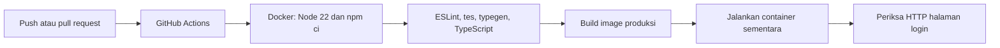

# Kenangin: Docker, CI, dan rencana CD

Folder kerja: `C:\Users\VICTUS\noitsume.github.io`.
Branch CI `docker-ci` dan publikasi `docker-publish` sudah di-merge. Branch lanjutan CD laptop: `local-cd`.

## Status persiapan

- Dockerfile dan `compose.yaml` lama tetap untuk development (`next dev`).
- `Dockerfile.production` membangun aplikasi dengan `next build`, lalu menjalankan hasil standalone menggunakan Node 22.
- CI telah diaktifkan melalui [PR #1](https://github.com/noitsume/noitsume.github.io/pull/1). [CI pada main berhasil](https://github.com/noitsume/noitsume.github.io/actions/runs/40731643694) untuk commit `84ce74c345fc4612d22d57655a1515e9b3b4c59d`.
- Job `publish-dockerhub` untuk `hwrdfarr/kenangin` telah berhasil melalui [workflow ini](https://github.com/noitsume/noitsume.github.io/actions/runs/40745368660), mengikuti [panduan Docker Hub](dockerhub.md).
- Target deploy dipilih **laptop Windows dengan Docker Desktop**. Konfigurasi dan skrip pembaruan otomatis tersedia pada [panduan CD lokal](local-cd.md). Perbaikan CSRF dan tesnya sudah termasuk PR #1.

Validasi lokal pada 28 Oktober 2026: lint, 74/74 tes, dan TypeScript lulus dalam Docker dengan Node 22.23.4; build produksi berhasil; container mencapai status `healthy`; halaman login, aset JavaScript, dan endpoint health merespons HTTP 200. Runtime memakai user non-root dan image tidak berisi `.env.local`. Container sementara untuk pemeriksaan sudah dihapus. Container development lama tetap berjalan. Validasi ini belum mencakup login nyata, upload, operasi layanan cloud, atau eksekusi workflow di GitHub.

## Alur CI yang sudah disiapkan



Workflow dipicu oleh push ke `main`, `development`, `docker-ci`, `docker-publish`, atau `local-cd`, dan pull request ke `main` atau `development`. Workflow menggunakan runner Ubuntu milik GitHub. Pemeriksaan aplikasi dijalankan **di dalam container Docker**; tidak perlu memasang runner GitHub Actions di laptop/server aplikasi. Job publikasi hanya berjalan setelah pemeriksaan berhasil, pada push atau pemicu manual di `main`. Pengujian pemulihan CD menggunakan PowerShell dengan Docker tiruan.

`next typegen` dijalankan sebelum `tsc` agar checkout bersih memiliki tipe route dan `next-env.d.ts`. Pemeriksaan yang gagal menghentikan tahap berikutnya. Tes menggunakan mock; CI ini tidak memerlukan private key Firebase, token B2, atau Gemini.

Image CI tanpa konfigurasi layanan hanya digunakan untuk memeriksa build/startup. Hasilnya bukan bukti login, upload, penyimpanan, dan AI sudah berhasil. Sebelum rilis, bangun image dengan konfigurasi publik yang benar dan uji fitur langsung.

## Mencoba pemeriksaan yang sama dari terminal VS Code

Jalankan Docker Desktop, lalu gunakan PowerShell:

```powershell
Set-Location -LiteralPath 'C:\Users\VICTUS\noitsume.github.io'
docker build --file Dockerfile.production --target checks --tag kenangin:checks .
docker build --file Dockerfile.production --tag kenangin:ci .
```

Perintah pertama menjalankan lint, unit test, dan pemeriksaan TypeScript. Perintah kedua membangun image produksi untuk pemeriksaan startup. Keduanya tidak memperbarui container aplikasi yang sedang berjalan.

## Menjalankan versi produksi lokal dengan konfigurasi aplikasi

Pastikan `.env.local` berisi konfigurasi layanan yang benar, termasuk `NEXT_PUBLIC_APP_URL=http://localhost:3000`. Jangan unggah file ini ke GitHub.

```powershell
docker compose --env-file .env.local -f compose.production.yaml build
```

Setelah build berhasil, hentikan container development agar port 3000 tersedia, kemudian jalankan produksi:

```powershell
docker stop kenangin
docker compose --env-file .env.local -f compose.production.yaml up -d --wait
docker compose --env-file .env.local -f compose.production.yaml ps
```

Buka `http://localhost:3000`. Untuk kembali ke development:

```powershell
docker compose --env-file .env.local -f compose.production.yaml down
docker start kenangin
```

Compose produksi menggunakan project `kenangin-production` agar container development yang sudah ada dapat dipakai kembali. Compose ini untuk uji lokal; akses host dibatasi ke `127.0.0.1:3000`.

## Konfigurasi build dan runtime

Kelima variabel berikut bersifat publik dan ditanamkan Next.js saat **build**:

```text
NEXT_PUBLIC_APP_URL
NEXT_PUBLIC_FIREBASE_API_KEY
NEXT_PUBLIC_FIREBASE_AUTH_DOMAIN
NEXT_PUBLIC_FIREBASE_PROJECT_ID
NEXT_PUBLIC_FIREBASE_APP_ID
```

Compose menggunakan `--env-file .env.local` untuk memasok build arguments tersebut. `env_file` pada service memasok variabel **runtime**. Kedua fungsi ini berbeda. Jika URL atau konfigurasi Firebase Web berubah, bangun ulang image. `NEXT_PUBLIC_APP_URL` harus sama dengan origin yang dipakai browser; konfigurasi ini juga memengaruhi pemeriksaan CSRF.

Firebase Admin private key, B2 application key, dan Gemini API key hanya diberikan saat runtime. Jangan menjadikannya Docker build arguments. `Dockerfile.production.dockerignore` mengecualikan env lokal, credential, cache, dan dokumen tugas dari konteks build produksi.

## Container dan port untuk laporan/video

| Komponen | Status | Port |
| --- | --- | --- |
| Container Kenangin development | Konfigurasi lama | Host 3000 → container TCP 3000 |
| Container Kenangin produksi lokal | Konfigurasi baru untuk dicoba | Host 127.0.0.1:3000 → container TCP 3000 |
| Container deployment dari Docker Hub | `compose.deploy.yaml` | Host 127.0.0.1:3000 → container TCP 3000 |
| Container pemeriksaan CI | Sementara selama workflow | Tidak memublikasikan port ke host |
| Firebase, B2, Gemini | Layanan eksternal, bukan container lokal | Koneksi keluar HTTPS TCP 443 |

Build stages `dependencies`, `source`, `checks`, `builder`, dan `runner` adalah tahapan pembuatan image. Itu bukan lima container layanan yang harus berjalan bersamaan.

Healthcheck memeriksa halaman login. `/api/health` memeriksa kelengkapan/format konfigurasi; keduanya tidak membuktikan koneksi cloud atau seluruh fitur bekerja.

## CD ke laptop sebagai server lokal

Pilihan akhir adalah laptop dengan Docker Desktop. Gunakan `http://localhost:3000`, `compose.deploy.yaml`, dan `scripts/deploy-local.ps1`. Image dari Docker Hub telah dideploy; lihat [panduan CD lokal](local-cd.md) untuk mengaktifkan worker, melihat log, menghentikan pembaruan, dan kembali ke development.

Alur yang digunakan:

```text
Merge main → CI lulus → build image → push Docker Hub
           → worker laptop menarik image → preflight → ganti container
```

Yang masih perlu dilengkapi untuk penyerahan tugas:

1. Kirim konfigurasi CD lokal melalui PR dari `local-cd` ke `main`.
2. Demonstrasikan satu pembaruan commit baru sampai container laptop berubah otomatis.
3. Uji fitur langsung dan rekam hasilnya, bukan hanya hasil healthcheck.
4. Lengkapi laporan dan satu video maksimal 15 menit dengan pembagian penjelasan ketiga anggota.

Mengunggah image ke Docker Hub saja belum memperbarui aplikasi di server. Jangan mengklaim deployment otomatis selesai sebelum pembaruan container di server berhasil didemonstrasikan.

Sebagai kolaborator, kamu dapat menyiapkan branch dan pull request jika memiliki akses write. Pemilik repo perlu membantu pengaturan yang membutuhkan hak admin, misalnya izin Actions, aturan branch, atau environment deployment. Jangan mengirim token/password melalui chat atau memasukkannya ke file sumber.

## Bukti tugas yang perlu direkam setelah alur lengkap

- Tampilkan latar belakang aplikasi, asal kode, dan kontribusi setiap anggota.
- Perlihatkan perubahan kode, commit, CI lulus, image Docker Hub, serta pembaruan aplikasi di server.
- Jelaskan diagram container, port host/container, dan layanan eksternal.
- Ambil capture langsung setiap fitur, termasuk login, membuat Room, kontribusi Collector, upload, publikasi/Receiver, audio, dan penghapusan sesuai fitur aplikasi.
- Cantumkan link repo GitHub, halaman Actions, Docker Hub beserta tag/digest, dan satu video maksimal 15 menit. Ketiga anggota terlihat dan menjelaskan bagian masing-masing.
- Lengkapi laporan Word sesuai format tugas. Catat hasil pengujian yang benar-benar dilakukan dan keterbatasan yang masih ada.

## Referensi

- [Next.js standalone output](https://nextjs.org/docs/app/api-reference/config/next-config-js/output)
- [Next.js self-hosting dan environment variables](https://nextjs.org/docs/app/guides/self-hosting)
- [Docker multi-stage builds](https://docs.docker.com/build/building/multi-stage/)
- [GitHub Actions quickstart](https://docs.github.com/en/actions/get-started/quickstart)
