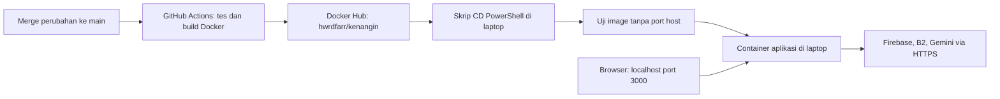

# CD Kenangin di laptop Windows

Laptop menjadi server lokal. GitHub menjalankan CI dan mengirim image ke Docker Hub; skrip PowerShell di laptop secara berkala menarik image yang baru lalu memperbarui container. Tidak perlu server cloud, SSH dari internet, atau GitHub self-hosted runner.

Folder proyek: `C:\Users\VICTUS\noitsume.github.io`. Branch persiapan: `local-cd`.



## File dan port

| Komponen | Fungsi / port |
| --- | --- |
| `compose.deploy.yaml` | Menjalankan image registry; tidak build dari source lokal |
| `scripts/deploy-local.ps1` | Menarik image, memeriksa kesehatan, deploy, serta memulihkan versi sebelumnya saat deploy gagal |
| `kenangin-deploy-kenangin-1` | Host `127.0.0.1:3000` menuju container TCP `3000` |
| `kenangin-preflight-*` | Container sementara untuk uji startup; tidak memublikasikan port ke host dan dihapus setelah diperiksa |
| Firebase/B2/Gemini | Layanan eksternal melalui koneksi HTTPS keluar TCP `443` |

CI berjalan pada runner GitHub dan memakai container untuk pemeriksaan aplikasi. Pengendali CD adalah proses PowerShell pada host laptop; aplikasi hasil deploy tetap berjalan di container. Port laptop dibatasi ke loopback, sehingga alamat `localhost` hanya dapat dibuka dari laptop itu.

## Cara kerja pembaruan

1. Setiap 300 detik, skrip menarik `hwrdfarr/kenangin:latest`.
2. Jika ID image sama dan container healthy, tidak ada restart.
3. Jika image berubah, skrip menguji image baru dalam container sementara menggunakan konfigurasi runtime yang sama.
4. Setelah uji berhasil, Compose mengganti container aplikasi menggunakan **ID image yang telah diuji**, bukan tag yang dapat berubah selama deploy.
5. Compose menunggu container baru healthy. Jika proses ini gagal, skrip mencoba menjalankan kembali ID image sebelumnya. Pemulihan ini bukan rollback data database.
6. Image yang gagal tidak dicoba berulang kali selama sesi Watch yang sama. Image baru berikutnya akan diperiksa; setelah memperbaiki konfigurasi, restart worker jika ingin mencoba image yang sama lagi.

Gangguan jaringan saat pull atau kegagalan preflight tidak menghentikan container aplikasi yang lama. Penggantian satu container dapat menyebabkan jeda akses singkat; ini bukan deployment tanpa downtime. Jika Docker Engine sendiri mati, skrip tidak dapat menjalankan pemulihan sampai Docker kembali aktif.

## Konfigurasi aplikasi

- GitHub repository variable `NEXT_PUBLIC_APP_URL` dan `.env.local` harus memakai `http://localhost:3000` untuk demonstrasi ini.
- Konfigurasi Firebase Web `NEXT_PUBLIC_*` sudah ditanamkan saat build image. Setelah mengubahnya di GitHub, bangun/publikasikan ulang image.
- Firebase Admin private key, B2 application key, dan Gemini API key tetap di `.env.local` laptop, diberikan hanya saat runtime. File itu tidak masuk Git atau image.
- Gunakan URL **localhost**, bukan alamat IP LAN, untuk demo HTTP lokal ini. Aplikasi produksi memakai cookie Secure; akses melalui domain/LAN memerlukan pengaturan HTTPS dan origin yang sesuai.
- Healthcheck menguji respons halaman login, bukan seluruh operasi layanan cloud. Login, upload, publikasi, audio, dan penghapusan tetap perlu dicoba langsung untuk bukti fitur tugas.

## Perintah dari terminal VS Code

Jalankan Docker Desktop terlebih dahulu. Semua perintah berikut dijalankan dari folder proyek:

```powershell
Set-Location -LiteralPath 'C:\Users\VICTUS\noitsume.github.io'
```

`ExecutionPolicy Bypass` di contoh berlaku hanya untuk proses PowerShell tersebut, tidak mengubah kebijakan Windows secara permanen.

Untuk **deploy pertama pada laptop baru** sambil mengganti container development dari folder proyek yang sama:

```powershell
powershell.exe -NoProfile -ExecutionPolicy Bypass -File scripts\deploy-local.ps1 -Mode Once -ReplaceDevelopment
```

Flag `-ReplaceDevelopment` hanya mengizinkan penghentian container development bernama `kenangin` apabila label Compose menunjuk folder proyek ini. Container itu tidak dihapus. Jika perpindahan pertama gagal, skrip berusaha menjalankannya kembali.

Untuk **mengaktifkan CD di latar belakang** (interval default 5 menit):

```powershell
powershell.exe -NoProfile -ExecutionPolicy Bypass -File scripts\deploy-local.ps1 -Mode Start
```

Perintah Start menggunakan jendela tersembunyi. Jalankan kembali setelah restart/logoff Windows; skrip belum dipasang sebagai layanan Windows atau startup task. Laptop harus menyala, tidak sleep, tersambung internet, dan Docker Desktop aktif agar pembaruan berlangsung.

Untuk **melihat status**:

```powershell
powershell.exe -NoProfile -ExecutionPolicy Bypass -File scripts\deploy-local.ps1 -Mode Status
docker compose -f compose.deploy.yaml ps
```

Untuk **menampilkan log CD secara langsung saat rekaman**:

```powershell
$workerInfo = Get-Content -LiteralPath '.\tmp\local-cd\worker.json' -Raw | ConvertFrom-Json
Get-Content -LiteralPath $workerInfo.log -Tail 20 -Wait
```

`Ctrl+C` pada penampil log hanya menutup penampil; worker CD tetap berjalan.

Untuk **menghentikan pembaruan otomatis**:

```powershell
powershell.exe -NoProfile -ExecutionPolicy Bypass -File scripts\deploy-local.ps1 -Mode Stop
```

Worker menyelesaikan siklus deploy yang sedang aktif sebelum berhenti. Container aplikasi tetap berjalan. Tunggu sampai Mode Status menyatakan worker tidak aktif sebelum deploy manual atau mulai worker baru.

Untuk demo singkat, setelah worker sebelumnya berhenti, interval dapat diubah menjadi 60 detik:

```powershell
powershell.exe -NoProfile -ExecutionPolicy Bypass -File scripts\deploy-local.ps1 -Mode Start -IntervalSeconds 60
```

Setelah demo, Stop lalu Start tanpa parameter interval untuk kembali ke 300 detik. Jika Docker Hub meminta autentikasi atau membatasi pull, login melalui Docker Desktop; skrip tidak menyimpan token registry di source code.

Untuk **kembali ke development**: hentikan worker, tunggu berhenti, kemudian:

```powershell
docker compose -f compose.deploy.yaml down
docker start kenangin
```

## Pengujian dan catatan deploy

- `tests/local-cd.tests.ps1` menguji enam skenario menggunakan Docker tiruan: deploy pertama, image tidak berubah, preflight gagal, rollback image lama, pemulihan development saat perpindahan pertama gagal, dan registry tidak dapat diakses. Tidak menggunakan daemon, kredensial, atau data cloud nyata.
- Catatan deploy nyata ada di `tmp/local-cd/deployment.json`; riwayat perubahan di `tmp/local-cd/events.jsonl`; log worker di `tmp/local-cd/watch-*.log`.
- Folder `tmp/` diabaikan Git. Catatan hanya memuat waktu, image ID, commit, dan peristiwa deploy; tidak merekam nilai kredensial.

```powershell
powershell.exe -NoProfile -ExecutionPolicy Bypass -File tests\local-cd.tests.ps1
```

Validasi 29 Oktober 2026: enam pengujian lulus pada Windows PowerShell 5.1 dan PowerShell 7. Deploy nyata image dari commit `9adeda08ef9b9c2cb099f0737d4b5198cee84154` berhasil. Halaman login, aset JavaScript, dan endpoint health merespons HTTP 200. Origin localhost dengan CSRF valid lolos hingga validasi body, sedangkan origin asing ditolak; request pengujian berhenti sebelum operasi Firebase. Dua siklus polling otomatis nyata teramati saat uji interval 30 detik tanpa restart container yang image-nya sama; interval kemudian dikembalikan ke 300 detik. Start, Stop yang tertib, dan pencegahan worker ganda telah diperiksa. Login dan operasi fitur cloud nyata belum diuji dalam pemeriksaan ini. Pembaruan dari commit GitHub baru berikutnya masih perlu direkam sebagai bukti demonstrasi.

## Simpan konfigurasi CD ke GitHub dan rekam demonstrasi

```powershell
git branch --show-current
git add -- compose.deploy.yaml scripts/deploy-local.ps1 tests/local-cd.tests.ps1
git add -- .github/workflows/ci.yml docs/local-cd.md docs/container-ci.md docs/dockerhub.md
git diff --cached --name-only
git commit -m "Add automatic local container deployment with recovery"
git push -u origin local-cd
```

Pastikan hanya tujuh file tersebut yang disertakan. Buat PR **base `main`**, **compare `local-cd`**, tunggu CI lulus, lalu tinjau dan merge. Job pengujian CD memakai simulasi; bukan menjalankan deployment laptop dari runner GitHub.

Untuk bukti alur lengkap:

1. Tampilkan commit/PR yang di-merge dan CI `main` berhasil.
2. Tampilkan tag commit baru pada Docker Hub.
3. Pastikan worker laptop aktif; tampilkan log deteksi image baru, preflight, dan deploy berhasil.
4. Bandingkan commit pada `deployment.json` dengan commit pada Actions. Container harus healthy dan URL localhost tetap dapat dibuka.
5. Untuk perubahan yang terlihat pada aplikasi, lakukan perubahan teks UI kecil yang disepakati tim, lalu ulangi alur melalui PR. Jangan menjalankan `docker build` lokal untuk demonstrasi ini: image harus datang dari pipeline dan registry.

## Referensi

- [Compose pull](https://docs.docker.com/reference/cli/docker/compose/pull/)
- [Compose up dan pemeriksaan kesehatan](https://docs.docker.com/reference/cli/docker/compose/up/)
- [Compose run tanpa port service](https://docs.docker.com/reference/cli/docker/compose/run/)
