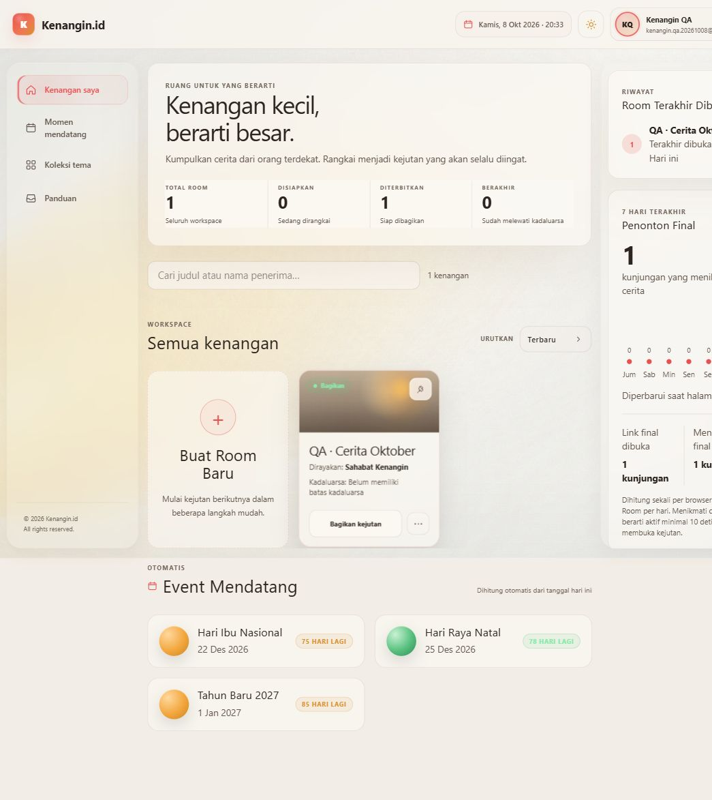
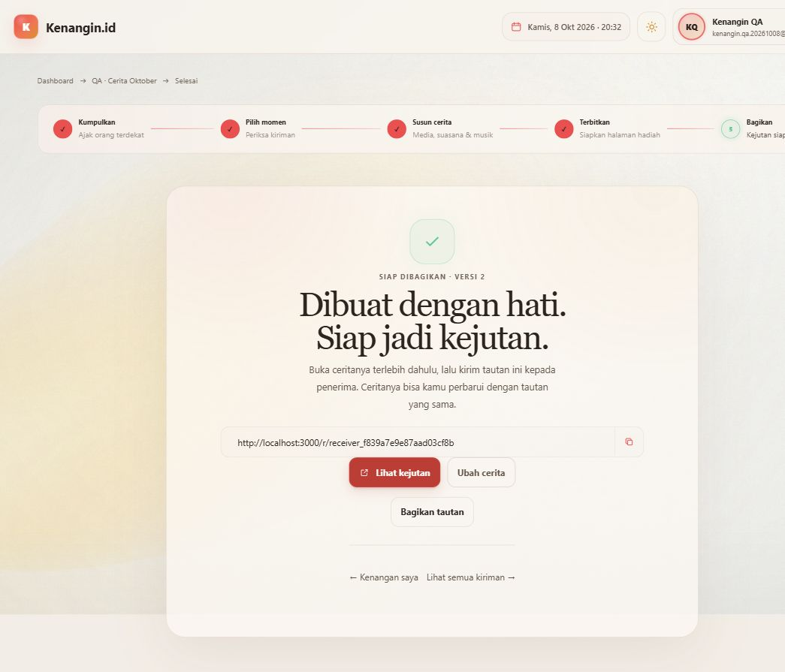
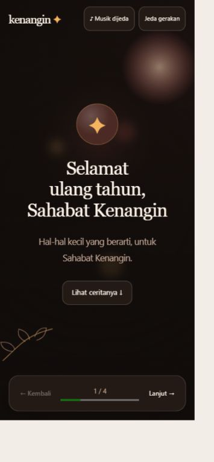
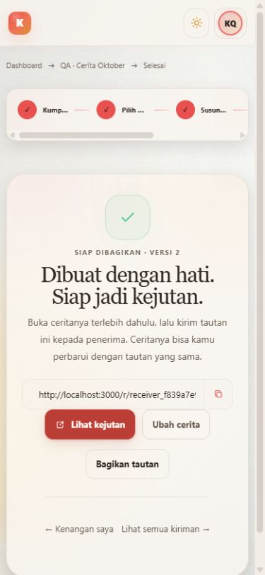

# Kenangin — hasil development produksi

Tanggal pemeriksaan: 8 Oktober 2026. Pekerjaan selesai dalam tiga fase pada
[rencana development](production-plan.md). Perubahan disiapkan di repository;
push dan deployment tetap dilakukan oleh pemilik project.

## Hasil utama

Kenangin tetap menjadi tempat membuat kejutan dari kiriman orang terdekat.
Alur utamanya sekarang memberi petunjuk dari keadaan Room yang tersimpan:
kumpulkan → pilih momen → susun cerita → terbitkan → bagikan. Studio mempunyai
empat langkah dengan tombol kembali/lanjut pada posisi yang konsisten.
Pengaturan lanjutan tetap tersedia melalui disclosure.

- Dashboard: pencarian judul/penerima, aksi kartu sesuai status Room, serta
  angka kunjungan tujuh hari dari data aktual. Menu Momen mendatang, Koleksi
  tema, dan Panduan mempunyai halaman yang berfungsi.
- Room dan Collector: langkah berikutnya jelas, moderasi Terima/Lewati,
  ucapan panjang dapat dibaca, draf teks dipertahankan, pengiriman ulang tidak
  menggandakan kiriman, serta batas unggahan dijelaskan sebelum mengirim.
- Studio: draf lokal tervalidasi, konfirmasi perubahan sebelum keluar,
  perlindungan terhadap perubahan dari tab lain, tiga gaya bawaan dengan
  tempo berbeda ketika Gemini gagal, dan peninjauan sebelum penerbitan.
- Penerbitan: versi terbit tersimpan secara atomik; penerbitan ulang menaikkan
  revisi dengan tautan penerima yang sama. Versi sebelumnya dapat dibuka saat
  pemilik menyunting draf. Kegagalan tidak ditampilkan sebagai keberhasilan.
- Penerima: tombol pembuka mengaktifkan audio, kontrol kembali/lanjut selalu
  tersedia, album memiliki kontrol manual, ucapan lengkap dibuka dalam dialog,
  serta musik merendah berdasarkan video yang benar-benar bersuara.
- Ketahanan: cache foto dan beat map mengikuti revisi; penyimpanan browser
  yang ditolak atau macet kembali ke jaringan. Pembatasan permintaan menggunakan
  Firestore sehingga berlaku lintas instance server. Penghapusan Room menandai
  proses terlebih dahulu dan mempertahankan metadata bila penghapusan file gagal.

## Bukti pengujian

| Pemeriksaan | Hasil dan cakupan |
| --- | --- |
| `npm run lint` | Lulus, tidak ada error atau warning ESLint. |
| `npm run typecheck` | Lulus. Build akhir juga menjalankan pemeriksaan TypeScript. |
| `npm run build` | Lulus pada Node 22.23.3, sesuai `engines.node: 22.x`; sebelumnya juga lulus pada Node 24.18.0. |
| `npm test` | 17/17 lulus pada Node 22 dan Node 24. |
| Registrasi sampai cerita terbit | Dijalankan melalui UI localhost menggunakan Firebase dan B2 yang dikonfigurasi di project, dengan akun dan media khusus QA. |
| Ubah cerita dan terbitkan ulang | Hasil `VERSI 2`, tetap memakai `receiver_f839a7e9e87aad03cf8b`, tiga media tetap tersimpan. |
| Keluar dari Studio tanpa menyimpan | Dialog tampil; pilihan Buang perubahan mempertahankan tiga media pada versi yang tersimpan. |
| Penerima | Foto, album 2/2, video lima detik, musik, halaman ucapan, dan dialog ucapan 3.000 karakter diperiksa. Escape mengembalikan fokus ke tombol pembuka. |
| Ponsel dan desktop | Override viewport 390×844 dan 1280×900. Zoom browser pengguna membuat viewport CSS aktual lebih kecil; pemeriksaan DOM memastikan tidak ada overflow horizontal pada halaman pendukung. |
| Menu dan halaman pendukung | Menu ponsel membuka halaman dan menutup dialog; pencarian tanpa hasil, lima tema beserta asetnya, agenda, panduan, dan persistensi tema terang/gelap diperiksa. |
| Maintenance | `npm run maintenance:dry-run -- --room=room_ba4388854d8146daa61d499c1f5e4a09` selesai; 0 staging terbengkalai, 0 analytics kedaluwarsa, 2 bucket pembatasan kedaluwarsa pada saat pemeriksaan. Tidak menghapus data. |

Test transaksi memakai adapter Firestore serial di dalam proses untuk memeriksa
invariant repository: token tetap, penolakan draf usang, status Room saat
dihapus, idempotensi kiriman/analytics, dan penghitungan kuota Room lama.
Ini bukan pengujian beban atau simulasi contention Firestore nyata.

Saat pengujian, Gemini mengembalikan 503/high demand dan timeout. Jalur pemulihan
berhasil menghasilkan tiga gaya bawaan, dipilih melalui UI, lalu diterbitkan.
Kualitas hasil Gemini yang berhasil tidak diklaim telah diverifikasi pada sesi ini.

## Akun dan data uji untuk pemeriksaan Firestore

- Nama: **Kenangin QA**.
- Email: **kenangin.qa.20261008@example.com**.
- Room: **QA · Cerita Oktober**.
- ID Room: `room_ba4388854d8146daa61d499c1f5e4a09`.
- Collector: `collector_d7c23520f6424ebcb45e7ac0a5207e08`.
- Receiver: `receiver_f839a7e9e87aad03cf8b`, revisi 2.
- Isi: dua gambar buatan khusus QA, satu video buatan berdurasi lima detik,
  serta satu ucapan 3.000 karakter dari Sahabat QA. Tidak memakai foto pribadi.

Kredensial akun tidak disimpan di repository. Data uji sengaja dibiarkan agar
pemilik dapat memeriksa hasilnya. Unggahan lokal berada di `tmp/qa` yang diabaikan Git.

## Pemetaan roadmap dan keputusan teknis

Roadmap 12 patch dipakai sebagai referensi, dengan pekerjaan sebelumnya tetap
dipertahankan. Bagian yang ditutup pada pekerjaan ini terutama perjalanan
pengguna, runtime penerima, analytics, cache, lifecycle, dan pemulihan kegagalan.
Riset dan sumber primer ada di [production-plan.md](production-plan.md).

Pilihan utama adalah panduan berdasarkan prasyarat yang tersimpan, bukan sekadar
restyle panel. Invariant-nya dapat diuji: Room dengan kiriman belum dipilih
mengarahkan pengguna ke moderasi; Room tanpa media mengarahkan ke unggahan;
cerita yang sudah terbit tetap menyediakan akses ke hasilnya. Mekanisme ini
mengurangi aksi yang saling bersaing, tetapi belum diuji melalui studi pengguna;
tidak ada klaim angka peningkatan konversi atau kemudahan pemakaian.

Cache persisten digunakan untuk foto dan beat map. Video dan musik tetap memakai
streaming/cache HTTP browser; memaksa semuanya menjadi Blob akan menambah
waktu awal dan penggunaan memori pada ponsel. Batas cache lokal maksimal
500 MB atau 15% estimasi kuota, dengan batas sumber individual dan penghapusan
berdasarkan penggunaan terakhir.

## Operasional setelah push

- Gunakan Node 22 dan environment Firebase, B2, serta Gemini yang sudah ada.
  Perubahan ini tidak menambah dependency atau variabel environment wajib.
- Dokumen analytics baru berada di subcollection Room; pembatasan permintaan
  berada di `requestLimits`. Tidak perlu migrasi massal: penghitung kuota Room
  lama diinisialisasi dari kiriman/media saat diperlukan.
- Jalankan `npm run maintenance:dry-run -- --room=<id>` untuk memeriksa satu Room.
  Tanpa `--room`, pemeriksaan dibatasi 200 Room. Opsi `--apply` benar-benar
  menghapus data yang memenuhi syarat; pemeriksaan ini tidak menjalankannya.
- Penghapusan Room kedaluwarsa memerlukan ketiga opsi `--apply`, `--room=<id>`,
  dan `--purge-expired-room`, serta lewat masa tenggang tujuh hari. Script tidak
  memasang scheduler otomatis. Jadwal retensi merupakan keputusan operasional.
- Batas publik: 100 kiriman/2 GB per Room; 8 file/600 MB per kiriman; foto 20 MB,
  video 200 MB. URL unggahan 15 permintaan/jam/IP/collector, submit 30/jam,
  reservasi unggahan 2 GB/hari/Room; pembuatan gaya 20 kali/hari/Room.
- Header IP pembatasan permintaan mengandalkan proxy hosting yang tepercaya.
  Bila hosting berbeda dari konfigurasi sekarang, pastikan proxy menulis ulang
  `x-forwarded-for` agar klien tidak dapat menghindari batas per IP.

## Batas verifikasi

- Belum diuji pada perangkat iOS/Safari atau Android fisik, screen reader,
  jaringan terbatasi, maupun pengukuran lapangan Core Web Vitals.
- Toggle gerakan diuji; preferensi reduced motion sistem diperiksa pada kode.
  Pemutaran animasi pada kecepatan 10% tidak tersedia melalui kontrol browser
  yang digunakan dan tidak diklaim sudah dijalankan.
- Tidak dilakukan penghapusan data nyata, simulasi kehilangan layanan B2,
  pengujian beban multi-instance, atau penjadwalan pembersihan otomatis.
- Sweeper hanya memindai prefix Room yang masih ada. Unggahan melalui URL
  bertanda tangan yang baru selesai sesudah Room dihapus masih dapat membuat
  objek tanpa parent; rekonsiliasi seluruh bucket/lifecycle B2 tetap pekerjaan
  operasional terpisah.
- Hasil build diverifikasi lokal dengan layanan backend sebenarnya. Hosting
  publik belum menerima perubahan ini sampai pemilik melakukan push/deployment.

## Bukti visual

Detail audit visual dan gerakan: [interface-review.md](interface-review.md).
