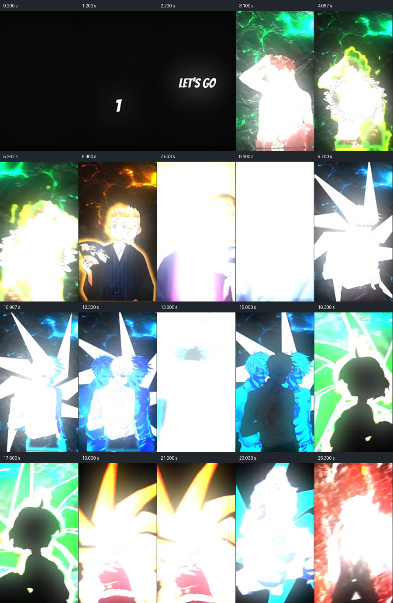
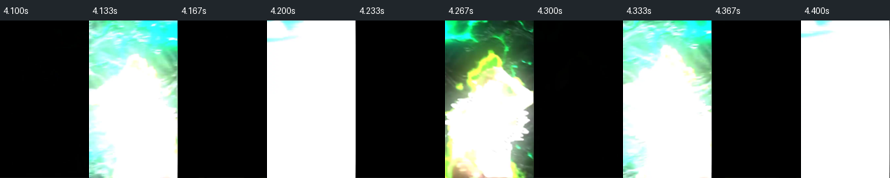
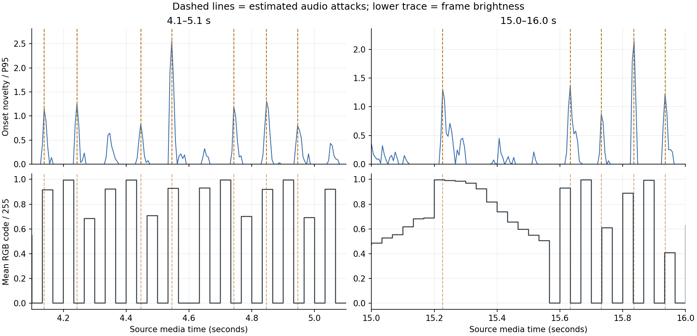
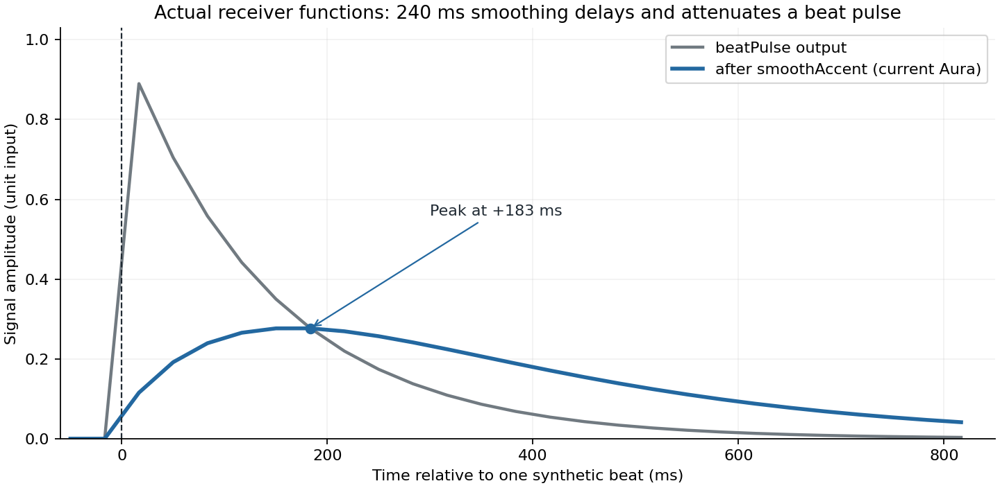

# Riset Aura — ritme visual, video referensi, dan arah implementasi

12 Oktober 2026 · Status: hasil pengukuran dan rancangan untuk diuji. Melengkapi [briefing Aura & Receiver v2](../briefing-aura-receiver-v2.md); belum mengimplementasikan renderer atau beatmap baru.

**Keputusan utama.** Bangun pengarah gerak yang membedakan suasana, ketukan, serangan bunyi, dan perubahan adegan. Keluarga bentuk Aura membaca data tersebut dengan respons yang berbeda. Prioritas pertama adalah memperbaiki ketepatan waktu, kemudian membuktikan satu keluarga **Rintik Resonansi** dengan lagu nyata, baru memperluas spektrum dan partikel. Menambah bentuk pada sinyal lama akan memperbanyak variasi, tetapi tetap mewarisi denyut yang tumpul dan kemungkinan grid beat meleset.

**Apa yang benar-benar diperiksa.** Video lokal didekode menjadi 827 frame dengan timestamp asli; waveform stereo dianalisis dengan dua ukuran jendela spektrum; frame statis diperiksa; fungsi produksi untuk pulse, smoothing, dan estimasi BPM dieksekusi pada masukan sintetis. Sumber primer dibaca untuk onset, tempo, sinkronisasi gerak, dan flash. Analisis ini tidak mencakup mendengar audio secara subjektif, anotasi beat oleh manusia, pengenalan judul/genre, atau pengujian kepatuhan flash pada tampilan akhir. Angka kandidat onset bukan not musik yang telah dikenali.

**1. Yang sebenarnya terjadi dalam video referensi**

Sumber: `YTDown.com_Shorts_Media_aOy9GnWUoag_Jedag-Jedug-Epilepsi-Sakit-Mata_001_480p.mp4`, dari file yang diberikan pengguna. Video 27,5667 detik, 30 fps; audio sekitar 27,6782 detik. SHA-256: `cd664e4f6cfbc825019ba4637955f5f591615d0f3ec25d397dca53d1f239054d`.

Lapisan yang terlihat pada sampel frame adalah figur/siluet, garis tepi berwarna, tekstur energi di belakang, sinar radial, penggandaan figur pada beberapa frame, perubahan palet, dan sisipan hitam/putih. Rasa intens berasal dari gabungan teknik tersebut. Zoom dan camera shake tidak diukur, sehingga tidak dinyatakan sebagai temuan terverifikasi.



Sampel storyboard memilih frame yang tidak hitam/putih bila tersedia dalam sekitar 160 ms dari waktu target, agar bentuk terlihat. Karena itu, gambar ini tidak dapat dipakai menghitung frekuensi flash. Pengukuran menggunakan seluruh frame.

| Rentang waktu | Temuan visual terukur | Implikasi desain |
| --- | --- | --- |
| 0–3 detik | Pembuka gelap dan teks; satu transisi hitam ke gambar | Ada persiapan sebelum intensitas tinggi |
| 3–9 detik | 46 transisi hitam ke gambar; sekitar 29% frame tergolong hitam | Hentakan dipertegas dengan pemutusan gambar |
| 9–15 detik | Tidak ada frame yang memenuhi definisi hitam; sekitar 13% hampir putih | Teknik visual berubah; bagian ini tetap mengandung perubahan terang, bukan bagian bebas flash |
| 15–21 detik | 73 transisi hitam ke gambar; sekitar 46% frame hitam | Pola penyisipan hitam menjadi lebih padat |
| 21–27,57 detik | 65 transisi hitam ke gambar; sekitar 44% frame hitam | Intensitas pemutusan gambar tetap tinggi |

Rentang tabel adalah pembagian untuk observasi, bukan hasil deteksi verse/chorus/drop. Total terdapat 248 frame hitam dan 67 hampir putih. Pengukuran memakai frame yang diperkecil menjadi 135 × 240 piksel. Definisi operasional: minimal 98% piksel memiliki seluruh kanal RGB ≤12 untuk hitam atau ≥243 untuk hampir putih. Transisi hitam ke gambar dihitung jika frame berikutnya bukan hitam dan rata-rata RGB/255 >0,04. Rata-rata kode RGB digunakan sebagai proksi kecerahan, bukan luminans relatif layar.

Beberapa rentang, misalnya 4,067–4,600 detik dan 15,533–16,067 detik, bergantian satu frame hitam dan satu frame gambar. Pada 30 fps, pola itu setara **15 siklus per detik selama burst tersebut**. Ini frekuensi pola frame, bukan estimasi BPM atau bukti bahwa setiap kedipan adalah ketukan musik.



**2. Apakah kedipannya mengikuti bass atau beat?**

Pertanyaan ini perlu pembanding: pada audio yang sangat padat, hampir semua frame akan dekat dengan suatu kandidat serangan bunyi secara kebetulan. Saya membandingkan 184 transisi hitam ke gambar setelah detik 3 dengan kandidat onset, lalu menggeser kandidat secara acak di dalam blok-blok dua detik sebanyak 400 kali. Pembanding lokal mempertahankan kepadatan kejadian tiap blok. Penghitungan memakai jarak melingkar yang sama untuk data asli dan pembanding.

| Sinyal audio, jendela 1.024 sampel | Transisi visual dekat kandidat dalam ±50 ms | Rata-rata pembanding yang digeser | Rentang persentil 5–95 pembanding |
| --- | ---: | ---: | ---: |
| Serangan seluruh spektrum, 20–8.000 Hz | 87,0% | 72,0% | 68,5–76,1% |
| Serangan frekuensi rendah, 20–180 Hz | 63,0% | 63,4% | 59,2–67,9% |

**Interpretasi terbatas:** hubungan temporal dengan serangan seluruh spektrum lebih terlihat daripada dengan bass saja pada metode ini. Ini tidak berarti 87% flash tepat pada beat. Pencocokan mengizinkan beberapa kejadian visual dekat dengan satu kandidat audio; bukan precision/recall terhadap anotasi manusia.

Ketika toleransi dipersempit menjadi ±20 ms, hasil seluruh spektrum hanya 30,4% dibanding 29,1% pembanding. Dengan jendela 2.048 sampel, hasil ±50 ms berubah menjadi 70,1% dibanding 60,4%. Jadi, bukti hubungan pada skala waktu kasar ada, tetapi ketepatan setiap hentakan belum terbukti dan hasil sensitif terhadap parameter.

Metode memakai audio 22.050 Hz, hop 128 sampel, selisih positif spektrum log, pengurangan rata-rata lokal 0,2 detik, dan peak picking. Daya kedua kanal dirata-rata agar kanal berlawanan fase tidak saling membatalkan. Ambang utama 0,65 × persentil 95; diuji pula 0,35 dan 1,0. Jarak kandidat minimum 100 ms membuat detektor ini **tidak dapat menguji semua kemungkinan serangan lebih rapat dari sekitar 10 kejadian/detik**. Resolusi video juga terbatas sekitar 33,3 ms/frame. Tidak ada dasar untuk menyatakan seluruh pola 15 Hz berasal dari, atau sepenuhnya lepas dari, audio.

Kalibrasi empat noise burst dengan waktu yang diketahui menghasilkan galat sekitar 5–9 ms; tes hening dan stereo berlawanan fase juga diperiksa. Itu memeriksa mekanisme pengukuran, bukan akurasi pada musik. Kandidat periodisitas global sekitar 99,4 / 74,4 / 149,8 / 59,4 BPM tidak dipilih menjadi satu BPM pasti. Ambiguitas tingkat pulsa memang merupakan masalah pengukuran tempo; [Tempogram Toolbox dari AudioLabs](https://www.audiolabs-erlangen.de/resources/MIR/tempogramtoolbox) membedakan tingkat pulsa dan perubahan tempo lokal.



Pelajaran yang diambil untuk Kenangin adalah **perubahan pola visual per bagian dan aksen yang memiliki struktur**. Mengulang strobo layar penuh dari referensi bukan syarat agar Aura terasa menghentak.

**3. Dua hambatan yang sudah terbukti di kode aktif**

Pada [playback.ts](../../lib/receiver/playback.ts), `beatPulse()` menurun sebagai `exp(-7 × umurBeat)`. [Receiver](../../components/receiver/receiver-experience.tsx) memasukkannya ke `smoothAccent()` dengan konstanta waktu 240 ms dan pembaruan sinyal sekitar 30 Hz.

Probe mengeksekusi fungsi tersebut langsung, dengan satu beat dan empat variasi posisi beat terhadap frame. **Puncak setelah smoothing muncul 167–187 ms setelah beat**, dengan amplitudo hanya sekitar 0,27–0,31 dari masukan unit. Sinyal mulai naik lebih awal; angka ini adalah keterlambatan puncak, bukan waktu sampai munculnya respons pertama atau latensi seluruh perangkat.



Model kontinu menjelaskan hasil itu. Dengan `a = 1/0,24` dan `b = 7`, respons filter adalah `a/(b-a) × (exp(-a t) - exp(-b t))`; puncaknya terjadi pada `ln(b/a)/(b-a)`, sekitar 183 ms. Masukan berulang, gain, CSS, dan jadwal render bisa mengubah hasil nyata.

Rekomendasi: pisahkan jalur serangan cepat dari jalur suasana yang dihaluskan. Amplitudo hentakan dihitung dari timestamp kejadian dan kurva peluruhannya, sedangkan kabut/warna/arus mengikuti perubahan energi perlahan. Menghapus semua smoothing akan membuat latar bergetar; mempertahankan satu smoothing untuk semua kanal menumpulkan hentakan.

Masalah kedua terdapat pada [music-client.ts](../../lib/studio/music-client.ts). Estimator mencoba BPM integer 60–180, mengubahnya menjadi lag yang dibulatkan pada bin 50 ms, lalu mempertahankan BPM pertama jika skor seri. Beberapa BPM memiliki lag yang sama, tetapi grid berikutnya dibuat dari BPM tersebut, bukan periode lag terpilih.

| Masukan sintetis ke fungsi estimator aktif | Hasil | Yang dibuktikan |
| --- | ---: | --- |
| Pulse 120 BPM, satu tiap 10 bin | 115 BPM | Kuantisasi lag dan pemilihan kandidat pertama menggeser BPM yang dilaporkan |
| Pulse 150 BPM, satu tiap 8 bin | 73 BPM | Pemilihan tingkat pulsa setengah dan kuantisasi perlu ditangani |

Untuk kasus 120 BPM, interval masukan adalah 0,5 detik, sedangkan grid 115 BPM berjarak 0,52174 detik: selisih bertambah sekitar 21,7 ms per beat. Ini derivasi dari kasus sintetis tersebut, bukan klaim bahwa semua lagu bergeser sebanyak itu. Perbaikan kecil dapat menghilangkan ketidaksesuaian lag/BPM, tetapi grid global tetap tidak cukup untuk lagu dengan tempo berubah. Beatmap berikutnya perlu menyimpan timestamp beat lokal dan kualitas perkiraannya.

Kurva energi sekarang dibatasi 160 titik: lagu 4 menit rata-rata diwakili satu titik per 1,5 detik. Itu cukup untuk bentuk energi kasar, bukan lokasi hentakan. Onset disimpan analyzer, tetapi jalur Aura aktif membaca beat atau energi. Jalur aktif ini adalah Web Audio di browser; integrasi librosa v2 masih pekerjaan mendatang.

**4. Data bunyi yang berbeda harus mempunyai tugas berbeda**

| Data | Arti yang dipakai Aura | Tugas visual |
| --- | --- | --- |
| Beat | Pulsa ritmis yang diperkirakan; tidak selalu ada bunyi keras tepat di sana | Gerak berulang yang menjaga rasa groove |
| Onset | Awal/perubahan serangan bunyi yang terdeteksi | Riak, hentakan lokal, percikan |
| Energi band rendah/menengah/tinggi | Kekuatan relatif bagian spektrum, bukan identitas instrumen pasti | Besar gelombang, bentuk pita, detail titik |
| Kurva energi lambat | Perubahan intensitas dalam rentang lebih panjang | Kedalaman, kepadatan, pembukaan ruang |
| Kandidat perubahan struktur | Pergantian karakter musik dalam rentang lebih panjang | Transisi pola yang jarang, setelah diperiksa atau disetujui pemilik |

Onset tidak sama dengan beat atau not C/D/E. Menemukan onset saja tidak mengidentifikasi kick, snare, piano, atau emosi lagu. [AudioLabs menjelaskan perbedaan onset, fase attack, dan sulitnya bunyi lembut/polifonik](https://www.audiolabs-erlangen.de/resources/MIR/FMP/C6/C6S1_OnsetDetection.html). Karena referensi menunjukkan hubungan yang lebih jelas dengan seluruh spektrum, gunakan onset seluruh spektrum sebagai kandidat waktu dan energi per band sebagai karakter respons; jangan menjadikan bass sebagai satu-satunya tombol aksen.

Novelty spektral membantu menangkap perubahan yang tidak tampak sebagai lonjakan volume besar. Kompresi log dan normalisasi lokal juga dapat mengangkat gangguan kecil: [mekanisme dan konsekuensinya dibahas di AudioLabs](https://www.audiolabs-erlangen.de/resources/MIR/FMP/C6/C6S1_NoveltySpectral.html). Maka bagian hampir hening perlu batas energi absolut; normalisasi tidak boleh mengubah desis menjadi klimaks.

Untuk vokal/strings bergetar, pertimbangkan pembanding **SuperFlux**, yang membandingkan spektrum dengan maksimum lokal pada frekuensi untuk mengurangi onset palsu akibat vibrato. Ini hasil metode dalam [Böck dan Widmer, Maximum Filter Vibrato Suppression for Onset Detection, DAFx 2013](https://phenicx.upf.edu/system/files/publications/Boeck_DAFx-13.pdf), bukan detektor emosi. Analyzer riset ini belum menerapkan SuperFlux; manfaatnya pada lagu Kenangin perlu diuji.

Detail waktu juga harus dinyatakan: [librosa onset_backtrack](https://librosa.org/doc/0.11.0/generated/librosa.onset.onset_backtrack.html) memindahkan deteksi ke minimum energi sebelumnya, berguna untuk titik potong audio. Titik itu tidak otomatis menjadi waktu serangan yang tepat untuk aksen visual. [frames_to_time](https://librosa.org/doc/0.11.0/generated/librosa.frames_to_time.html) dapat menambahkan offset setengah FFT untuk STFT yang tidak centered; menambahkan koreksi yang sama dua kali akan menggeser sinkronisasi. Simpan konvensi waktu, lalu kalibrasikan keseluruhan extractor memakai fixture yang diketahui waktunya.

**5. Bentuk Aura: tiga keluarga dengan bahasa gerak yang konsisten**

Rekomendasi artistik ini adalah hipotesis untuk prototipe, bukan keluaran klasifikasi mood yang sudah terbukti. Tempo mengatur kecepatan, serangan mengatur hentakan, dan pilihan suasana pemilik mengatur palet serta izin jenis aksen. Lagu sad bisa cepat dan memiliki drum keras; BPM tinggi tidak memberikan izin flash.

| Keluarga | Komposisi latar | Respons yang terasa mengikuti bunyi | Aksen dekat media |
| --- | --- | --- | --- |
| **Rintik Resonansi** — prioritas pertama | Titik bulat dengan kedalaman, lingkaran tipis yang menyebar, area tengah lapang | Onset terpilih membuat pusat riak muncul tepat pada kejadian; energi rendah memperbesar dorongan, lalu riak meluruh | Cincin/tepi lembut, tidak menimpa foto atau teks |
| **Arus Cahaya** | Partikel dan pita yang mengalir dalam medan arah perlahan | Energi lambat mengatur arus; onset memberi dorongan kecepatan singkat pada kumpulan partikel | Sapuan cahaya lokal atau lintasan tipis di tepi media |
| **Spektrum Ruang** | Pita, lengkung kontur, atau garis radial yang memvisualisasikan kelompok frekuensi | Bentuk per band mengikuti energi band; onset memberi penegasan sesaat, beat menjaga pola gerak | Kompresi singkat bingkai dekoratif dan gelombang yang terlepas ke latar |

Titik bulat/bokeh, riak hujan, debu berarus, aurora/pita, kontur topografi, dan spektrum radial menjadi variasi bentuk dalam keluarga tersebut. Bukan semua efek dinyalakan bersamaan. Satu keluarga dominan per bagian, dengan perubahan yang berkesinambungan.

Contoh pemetaan yang harus dibuktikan dengan lagu:

- **Warm:** titik besar dan jarang, warna lembut, arus lambat; onset membangkitkan riak kecil dengan peluruhan panjang. Intensitas dapat naik tanpa menambah kedipan.
- **Sad:** riak tipis, ruang kosong lebih luas, jejak panjang; serangan piano/vokal terpilih memunculkan detail lokal. Aksen cahaya tajam tetap mati meski ada puncak volume.
- **Groove sedang:** partikel berayun/pita bergeser dengan pulsa yang stabil; beberapa onset menjadi percikan. Ketukan yang kosong tidak memerlukan ledakan.
- **Heavy bass/montagem:** pola ruang lebih tegas; serangan kuat memberi kompresi singkat, gelombang keluar, dan dorongan partikel. Detail frekuensi tinggi boleh lebih rapat tetapi lebih kecil. Cahaya tajam merupakan aksen terpilih, bukan respons setiap frame.

Untuk menjaga sebab-akibat, satu kejadian dipakai bersama: pada waktu `t`, bagian dekoratif mencapai momen hentak; riak dilepas dari lokasi yang sama; partikel menerima arah dorongan yang berkaitan; semuanya meluruh menurut karakter dunia tersebut. Posisi dapat bervariasi memakai seed dari ID kejadian, sehingga replay tetap konsisten.

**Sinkronkan momen yang terlihat sebagai ketukan.** Tetesan yang mulai jatuh saat beat lalu mendarat 200 ms kemudian akan menempatkan benturan di waktu lain. Untuk beatmap praanalisis, jatuh dapat disiapkan sebelumnya agar mendarat pada timestamp; alternatif sederhana adalah memunculkan pusat riak pada timestamp tanpa animasi jatuh. Studi [Audiovisual synchrony perception in observing human motion to music, 2019](https://pmc.ncbi.nlm.nih.gov/articles/PMC6711538/) menemukan titik akhir/terendah gerakan selaras dengan musik pada gerakan yang diuji, bukan awal geraknya. Penerapan ke partikel/riak adalah **hipotesis lintas konteks**, perlu A/B; rentang toleransi perseptual dalam studi itu tidak dipakai sebagai anggaran keterlambatan aplikasi.

**6. Foreground dan background: pisahkan sumber audio dari kedalaman visual**

Saat ini [AuraSignals](../../lib/receiver/aura-state.ts) berisi dua angka `foreground/background` yang berasal dari transport audio section dan musik latar. Di [renderer](../../components/receiver/aura-environment.tsx), `uBack` memengaruhi cahaya/ring, sedangkan `uFront` dikirim tetapi belum dipakai dalam perhitungan warna shader. Sebagian respons depan berada di CSS bayangan media melalui `--beat`. Ini belum sistem dua lapisan visual dengan peran lengkap.

Rancangan berikutnya:

1. Setiap sumber musik memiliki jam, beatmap, volume, dan status audible sendiri. Jika section memakai sumber yang sama dengan musik latar, kejadian tidak boleh dihitung dua kali.
2. Tentukan sumber ritme dominan dari musik yang benar-benar terdengar dan pilihan section. Saat dua lagu berbeda bertumpuk, latar yang diredupkan masih dapat memberi tekstur energi, tetapi tidak menembakkan ritme kedua yang bersaing.
3. Sumber terpilih menggerakkan kedua kedalaman visual. **Belakang** menjaga suasana dan skala ruang; **dekat media** memberi sedikit penekanan pada kejadian terpilih. Satu lagu cukup untuk keduanya.
4. Saat pesan panjang dibaca, kurangi kerapatan/besar detail dan buka area baca; waktu beat tetap sama. Saat musik pause/mute/waiting/gagal, gerak otomatis berhenti sesuai keputusan pengguna sebelumnya.

Pemilihan keluarga dan suasana jangan berubah setiap kali fitur audio melewati ambang. Pilihan pemilik tetap stabil; penyesuaian intensitas memakai rentang waktu lebih panjang. Bila perkiraan audio meragukan, pertahankan keluarga dan respons energi yang lembut, bukan menebak genre baru.

**7. Beatmap v2 yang layak dibangun**

Peningkatan dibutuhkan pada makna dan ketepatan waktu data. Analisis rinci dilakukan saat menyiapkan musik, kemudian receiver membaca hasilnya; tidak perlu menjalankan Python/librosa di tiap browser penerima. Tempat eksekusi/job server perlu diputuskan saat integrasi setelah biaya dan batas lingkungan diukur.

| Bagian kontrak yang diusulkan | Isi minimum | Pemakai |
| --- | --- | --- |
| Identitas dan waktu | Versi skema/extractor, hash audio yang benar-benar diputar, durasi, sample rate, hop, konvensi centering, offset terukur | Cache, validasi, sinkronisasi |
| Beat | Timestamp lokal; skor kualitas yang metode perhitungannya dinyatakan | Pola ritmis, persiapan gerak |
| Serangan | ID, timestamp, strength, kontribusi band rendah/menengah/tinggi | Riak dan aksen |
| Kurva kontinu | Energi band dan energi lambat dengan interval sampel eksplisit | Arus, skala, kepadatan |
| Spektrum ringkas opsional | Kelompok log/Mel untuk variasi bentuk | Keluarga spektrum saja |
| Struktur opsional | Kandidat perubahan dengan kualitas atau cue buatan pemilik | Pergantian pola yang jarang |

Angka awal untuk uji: kurva energi 20 Hz, spektrum 32 band pada 20 Hz, dan onset dari hop yang lebih rapat seperti eksperimen ini. Ini parameter prototipe, bukan spesifikasi final. Pada 4 menit, 32 × 20 × 240 = 153.600 nilai; float32 mentah sekitar 600 KiB sebelum metadata/kompresi. JSON dapat lebih besar. Event timestamp disimpan terpisah sehingga mengecilkan kurva latar tidak menghapus ketepatan serangan.

`quality` bukan probabilitas kebenaran kecuali telah dikalibrasi. Skor band rendah juga bukan label kick. Versi pertama tidak memerlukan transkripsi MIDI lengkap, pemisahan stem, atau model klasifikasi emosi. Tambahan tersebut baru masuk bila evaluasi menunjukkan kegagalan yang tidak dapat diatasi oleh fitur lebih ringan.

Data v1 tetap dibaca lewat adaptor kemampuan: jika hanya tersedia beat/energi, renderer memakai kemampuan itu dan tidak mengarang onset/band/struktur. Validasi hash mencegah beatmap musik lama dipakai untuk file hasil trim/transcode yang waktunya berubah.

**8. Kontrak waktu dan kerja sama library**

Renderer membaca waktu transport audio, bukan menghitung sendiri beat dengan `setInterval`. Pada waktu `t`, umur suatu kejadian adalah `t - event.time`; bentuk dihasilkan dari umur itu. Pause, playback rate, loop, seek, dan pergantian sumber harus melewati kontrak yang sama. Offset perangkat/decoder diukur terpisah, tidak disamarkan dengan konstanta kreatif.

Untuk partikel sederhana, misalnya kecepatan meluruh `v(a)=v0 × exp(-a/τ)`, posisi dapat dihitung langsung sebagai `p(a)=p0+v0 × τ × (1-exp(-a/τ))`. Integrasi analitik ini memungkinkan seek ke waktu mana pun tanpa mengulang seluruh simulasi, dengan seed dan batas umur yang tetap. Riak prosedural juga dapat dihitung langsung dari umur. Sebaliknya simulasi cairan/feedback yang menyimpan keadaan memerlukan replay atau checkpoint; itu alasan teknis untuk memulai dengan bentuk prosedural.

Saat seek, rekonstruksi hanya kejadian yang masih mempunyai umur visual aktif; jangan menembakkan semua beat yang terlewati. Frame yang terlambat harus menggambar keadaan sesuai waktu kini, bukan mengantre efek lama.

| Alat/library | Tanggung jawab saat implementasi |
| --- | --- |
| Python/librosa + FFmpeg | Decode dan analisis praputar; ekspor kontrak terversi; fixture waktu |
| Three.js/R3F | Menggambar riak, pita, partikel dan membaca sinyal/jam yang sama |
| GSAP | Pembukaan ruang dan perpindahan komposisi; animasi yang bergantung musik harus disinkronkan ke transport |
| Postprocessing | Penuntasan gambar yang dipakai seperlunya; bloom bukan pengganti pola gerak |
| MCP Three.js lokal | Inspeksi scene/uniform/performa pada sesi pengembangan; tidak menjadi layanan runtime penerima |
| Playwright/browser tools | Menguji play/pause/seek, kesamaan preview-receiver, komposisi dan rekaman untuk pengukuran |
| Context7/sumber primer | Memeriksa semantik API dan keterbatasan algoritma sebelum integrasi |

Dalam riset ini, bukti utama diperoleh dari FFmpeg, Python, probe fungsi TypeScript, Context7, dan sumber web. MCP Three.js dan Playwright tidak dijalankan ulang karena belum ada renderer baru untuk diverifikasi. Tidak ada dependency yang dipasang dalam pekerjaan riset ini.

**9. Aturan aksen cahaya**

Pilihan room sebaiknya membedakan suasana/intensitas dari izin aksen cahaya. Default warm/sad menonaktifkan aksen tajam. Jika diizinkan, kandidat harus melewati pemeriksaan strength, konteks bagian, jarak dari aksen sebelumnya, sumber dominan, dan batas komposisi. Bila kandidat ditolak, gelombang atau dorongan partikel masih dapat mengikuti bunyi yang sama.

Pemeriksaan berlaku pada gambar akhir gabungan, termasuk video pengguna dan postprocessing. Dua efek yang masing-masing jarang dapat bertumpuk menjadi pola lebih rapat. **Toggle izin bukan bukti keamanan.** [WCAG 2.2 SC 2.3.1](https://www.w3.org/WAI/WCAG22/Understanding/three-flashes-or-below-threshold.html) membatasi lebih dari tiga flash pada sembarang rentang satu detik kecuali di bawah ambang area/luminans/merah yang ditentukan. Area tersebut bukan sekadar 25% viewport. Ukuran RGB dalam riset ini tidak menguji ambang itu; renderer akhir perlu diperiksa pada ukuran tampil terbesar. Tidak ada klaim semua pengguna pasti aman.

**10. Urutan pembuktian dan kriteria berhenti**

1. **Perbaiki dasar waktu:** tambahkan jalur impact terpisah; tangani masalah lag/BPM; pertahankan perilaku berhenti saat audio berhenti. Uji click track dan onset yang diketahui, termasuk seek dan loop.
2. **Buktikan extractor v2:** bandingkan onset energi, novelty spektral, dan varian tahan vibrato pada kumpulan kecil yang diberi anotasi manusia. Sertakan piano/vokal sad, warm akustik, groove, heavy bass, perubahan tempo, hening, dan musik sangat terkompresi. Ukur missed event, false event, galat waktu, dan ambiguitas half/double tempo secara terpisah.
3. **Bangun satu potongan Rintik Resonansi lengkap:** satu transport, satu beatmap, dua karakter respons warm dan impact, konten receiver yang sama. Bandingkan A/B momen benturan tepat beat melawan animasi yang baru dimulai saat beat. Ini uji rasa sinkron, bukan hanya screenshot.
4. **Perluas keluarga setelah dasar lolos:** Arus Cahaya lalu Spektrum Ruang. Setiap kanal tambahan harus punya pemakai visual dan alasan yang dapat diukur.
5. **Validasi komposisi dan perangkat:** baca teks panjang, foto terang/gelap, video dengan audio, portrait/landscape, reduce motion, serta ponsel sasaran. Ukur frame time dan delay tanpa mengurangi desain secara diam-diam.

Target awal instrumentasi: p95 galat penempatan momen impact terhadap timestamp yang benar ≤50 ms pada perangkat uji, dengan laporan outlier maksimum dan titik ukur yang jelas. Angka ini target engineering untuk prototipe, bukan hasil yang telah tercapai atau batas perseptual universal. Ukur galat extractor, scheduler/render, dan keluaran perangkat secara terpisah sebelum menyimpulkan sinkronisasi ujung ke ujung.

Risiko paling relevan: vokal dianggap drum, normalisasi memperbesar noise, BPM setengah/ganda, dua sumber mengirim aksen bersamaan, offset akibat trim/centering, dan efek tertunda setelah seek. Jika label jenis serangan tetap buruk pada data beranotasi, barulah evaluasi pemisahan perkusif atau model khusus. Jika desain tetap tidak terasa sinkron walau timestamp benar, ubah kurva/momen visual berdasarkan A/B, bukan menambah jumlah flash.

**Bukti dan reproduksi**

- [Angka lengkap dan parameter](aura-reference-2026-10-12/measurements-v2.json), [kandidat onset](aura-reference-2026-10-12/onset-candidates.csv), [timeline penuh](aura-reference-2026-10-12/timeline.png).
- [Probe fungsi aplikasi dan hasil tempo](aura-reference-2026-10-12/current-aura-response.json), [kurva numerik](aura-reference-2026-10-12/current-aura-response.csv).
- [Analyzer referensi](../../tools/audio-research/analyze_reference.py), [probe fungsi aktual](../../tools/audio-research/check_aura_response.cjs), [pengemasan bukti](../../tools/audio-research/package_report.py).

Jalankan dari root proyek, menggunakan Python yang memiliki NumPy, SciPy, Matplotlib, Pillow dan FFmpeg/ffprobe di PATH. Script riset tidak memerlukan librosa. Media referensi tetap dibaca dari file lokal asli.

```powershell
python tools/audio-research/analyze_reference.py 'C:\Users\KEVIN\Downloads\YTDown.com_Shorts_Media_aOy9GnWUoag_Jedag-Jedug-Epilepsi-Sakit-Mata_001_480p.mp4' --output tmp/aura-reference-deep
node tools/audio-research/check_aura_response.cjs
python tools/audio-research/package_report.py
```

Laporan menyimpan snapshot keadaan kode saat riset. Menjalankan ulang probe setelah kode diperbaiki akan menghasilkan angka baru; perbedaan tersebut harus dicatat sebagai hasil perbaikan, bukan digunakan untuk mengubah arti hasil awal secara diam-diam.
